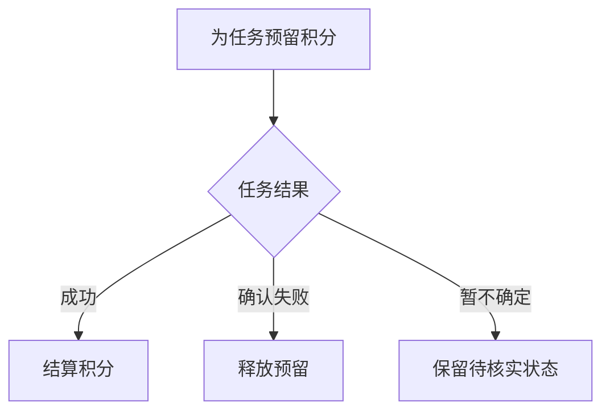
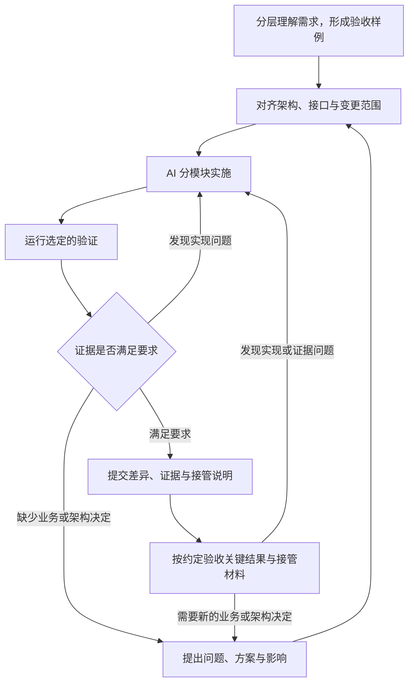

# 论 AI 对软件工程的影响与重构

**代码越来越容易生成之后，人如何继续掌控软件？**

## 摘要

AI 正在扩大软件开发中可以交给机器执行的工作范围，但实现速度的提升，并不会自动转化为更轻松、更可控的开发过程。当业务判断、架构协调和结果验证集中到维护者身上时，人的注意力可能成为新的约束。本文以人的代码掌控度为核心，讨论 AI 如何改变软件工程中的分工，并提出一套从需求到验证的协同方法：按模块组织需求，以“总体流程—局部细节—整体约束”逐层建立理解；同步形成需求与验收样例；用架构基线和接口契约限定 AI 的自主范围；根据风险选择测试范围与执行环境，并明确停止条件。文章以“视频生成失败不扣积分”为贯穿示例，说明这些原则如何落实到日常开发。本文属于概念分析与方法设计，实际收益仍需通过项目实践和对照研究检验。

**关键词**：AI 编程；软件工程；代码掌控度；注意力；接口契约；需求与测试

## 1 引言

设想这样一个开发场景。

你给 AI 提了一个需求：“用户生成视频，如果生成失败，就不要扣积分。”

AI 很快开始工作。它修改了页面，补上了接口，在后台增加了一些状态判断，又为新增逻辑写了测试。最后，它告诉你：功能已经完成，测试全部通过。

看起来，一次协作顺利结束了。

但当你打开代码，准备接着做下一个需求时，问题出现了：为什么积分逻辑出现在页面里？为什么为了处理失败，任务模块和支付模块都被改了一遍？那个原本只负责调用服务商的类，什么时候开始决定用户应不应该扣费了？

更难回答的问题是：如果用户说“视频没出来，积分却没了”，你能否迅速判断，应该从哪里查起？

这个场景揭示了一种值得认真对待的变化：**功能可以被完成，但维护者对功能的理解，未必随之增长。** 如果这样的迭代不断发生，项目可能一边增加能力，一边变得越来越难以接手。

软件工程原本就包含需求、设计、构建、测试和维护等相互关联的活动。[1] AI 让其中一部分执行变得更容易，也让我们重新面对一个老问题：谁负责理解整个系统，谁有权决定它怎样变化，又由什么证据证明变化是正确的？

本文的核心判断是：**AI 时代的软件工程，需要把人的代码掌控度作为持续维护的工程目标。** 人应当能够理解关键结构、解释重要行为、预判修改影响，并在必要时接管代码。在这个前提下，AI 才能获得稳定而充分的自主执行空间。

接下来，文章会依次讨论：AI 到底改变了哪些工作；为什么人可能写得更少却更累；如何通过需求表达、架构、接口和测试，让这种协作真正减轻负担。贯穿全文的“视频生成”案例是用于解释方法的设计示例，不代表已经完成的项目实验。这里的“人”也可以是一支有明确职责分工的团队，并不要求某一个开发者理解大型系统的全部细节。

## 目录

- [1 引言](#1-引言)
- [2 相关研究与理论基础](#2-相关研究与理论基础)
  - [2.1 代码写得快，项目就一定做得快吗](#21-代码写得快项目就一定做得快吗)
  - [2.2 软件工程一直在解决人与人的协作问题](#22-软件工程一直在解决人与人的协作问题)
  - [2.3 模块和接口，是让人能够理解复杂系统的办法](#23-模块和接口是让人能够理解复杂系统的办法)
  - [2.4 人的注意力，不能按机器的输入方式安排](#24-人的注意力不能按机器的输入方式安排)
- [3 代码掌控度的概念与问题分析](#3-代码掌控度的概念与问题分析)
  - [3.1 掌控代码，意味着你随时有办法接手](#31-掌控代码意味着你随时有办法接手)
  - [3.2 AI 为什么可能让人写得更少，却想得更多](#32-ai-为什么可能让人写得更少却想得更多)
  - [3.3 最危险的变化，是边界在实现过程中悄悄移动](#33-最危险的变化是边界在实现过程中悄悄移动)
- [4 以代码掌控度为核心的人机协同方法](#4-以代码掌控度为核心的人机协同方法)
  - [4.1 需求按模块拆开，也要按人的理解顺序展开](#41-需求按模块拆开也要按人的理解顺序展开)
  - [4.2 需求与测试，从讨论规则时就建立联系](#42-需求与测试从讨论规则时就建立联系)
  - [4.3 架构先有边界，AI 才有自主空间](#43-架构先有边界ai-才有自主空间)
  - [4.4 用接口统一业务，用设计模式收住变化](#44-用接口统一业务用设计模式收住变化)
  - [4.5 测试要选择合适的范围，也要知道何时停止](#45-测试要选择合适的范围也要知道何时停止)
  - [4.6 把需求、实现与验证接成一条工作流](#46-把需求实现与验证接成一条工作流)
- [5 应用示例与评价设计](#5-应用示例与评价设计)
  - [5.1 新增一个服务商，怎样限制变化的范围](#51-新增一个服务商怎样限制变化的范围)
  - [5.2 一次交付，应该留下怎样的证据](#52-一次交付应该留下怎样的证据)
  - [5.3 这套方法是否有用，需要怎样检验](#53-这套方法是否有用需要怎样检验)
- [6 讨论](#6-讨论)
  - [6.1 约束的强度，应当与项目需要相称](#61-约束的强度应当与项目需要相称)
  - [6.2 文档、接口和测试，都有自己的盲区](#62-文档接口和测试都有自己的盲区)
  - [6.3 AI 越能执行，工程越要重视可解释的交付](#63-ai-越能执行工程越要重视可解释的交付)
- [7 结论](#7-结论)
- [参考文献](#参考文献)
- [附录 A 模块任务执行提示词](#附录-a-模块任务执行提示词)

## 2 相关研究与理论基础

### 2.1 代码写得快，项目就一定做得快吗

讨论 AI 编程，很容易把注意力放在它能写多少代码、能解决多复杂的问题上。这些能力当然重要。SWE-bench 把真实代码仓库中的问题与相应修改结合起来，体现了编程能力评价向仓库级任务的扩展。[2]

但一个系统能够解决某类编程题，与一个团队能够更快、更稳地完成开发，是两个需要分别验证的问题。

一项面向 95 名开发者的随机实验，要求参与者完成一个 JavaScript HTTP 服务任务。在完成任务的参与者中，使用 GitHub Copilot 的一组平均完成时间缩短了 55.8%。这是特定任务上的显著收益，但它并没有测量一个产品从需求讨论到长期维护的全部过程。[3]

另一项由 METR 开展的研究，让 16 名熟悉各自开源项目的开发者处理 246 个真实任务。研究发现，在其测试的早期 2025 年工具与工作条件下，允许使用 AI 的任务平均耗时反而增加了约 19%。[4] METR 在 2026 年的后续更新中又指出，新的观察出现了加速迹象，但参与选择、报酬安排和并行工作计时等问题，使它无法据此给出可靠的当前总体收益估计。[5]

这些结果提醒我们，要把“快”说清楚：是谁，在什么项目里，使用什么工具，完成哪一段工作，最后又如何确认质量。

对一个陌生的小任务，AI 可能帮助开发者迅速跨过实现门槛；对一个高度熟悉、历史约束很多的项目，阅读生成结果、纠正偏差和解释上下文，也可能占去不少时间。具体收益需要在具体条件下判断。

因此，本文关注一笔更完整的工程账：写代码节省的时间，能否覆盖理解需求、解释上下文、审查变更、运行测试和后续维护所增加的投入。只有把这些工作一起算进去，才能知道开发究竟有没有变轻松。

### 2.2 软件工程一直在解决人与人的协作问题

在分工成熟的团队里，业务知识通常分散在不同角色之间。产品人员解释用户目标，架构负责人维护系统边界，开发者实现模块，测试人员检查预期与实际之间的差距。一个人不必独自承担所有判断。

这并不意味着过去的程序员不需要懂业务。更准确地说，组织可以通过分工、文档、评审和沟通，帮助开发者获得当前任务所需的业务信息。

Conway 对组织沟通结构与系统设计之间关系的观察，提供了理解这种现象的一个角度：系统怎样被组织，与参与者怎样协作存在联系。[6] 借助这个视角，可以进一步追问：当部分参与者变成 AI，原来的协作方式还能原样使用吗？

设想一个开发者同时让 AI 写前端、写后端、补数据库迁移、生成测试。原本需要几个人分别完成的执行任务，确实可以被集中推进。但业务冲突由谁解决？接口含义由谁统一？数据是否允许丢失、失败是否需要补偿，又由谁决定？

如果这些判断没有明确归属，它们就会落到最后负责交付的人身上。

这也是本文对 AI 重构软件工程的一项判断：**执行工作的集中，并不自动消除协调工作；它可能让协调责任变得更加集中。** 当一个人借助 AI 承担更多角色时，工作流就必须帮助他管理这些判断。

### 2.3 模块和接口，是让人能够理解复杂系统的办法

软件工程早已有一套应对复杂性的思想。

Parnas 讨论模块划分时，强调围绕需要隐藏的设计决策建立边界。[7] 这意味着，模块的价值不仅是把文件放进不同目录，还在于让一部分变化能够留在内部，外部不必跟着理解和修改。

例如，一个生成服务商改变了签名算法，维护者应当主要在接入它的模块里处理。积分模块关心的是任务是否得到可靠的结果，没有必要了解签名字符串怎样拼接。

契约设计则进一步明确调用双方的责任：调用前需要满足什么条件，完成后应当保证什么，以及哪些约束在约定的操作边界上必须保持。[8]

这些思想对 AI 协作同样有用。清晰的模块边界，能够缩小一次任务需要理解的范围；明确的契约，能够让人与 AI 对“做对了”形成共同依据。

由此可以形成一种有用的分工：**人重点关注模块职责、接口语义和关键约束，AI 重点承担边界内的实现。** 维护者仍然保留深入代码的能力，但不必为了理解一个功能，先重新读懂整个项目。

### 2.4 人的注意力，不能按机器的输入方式安排

AI 可以一次生成长篇说明、完整时序图和大量测试结果。对人而言，这些内容是否有帮助，还取决于它们怎样出现。

Simon 在讨论信息丰富的组织时，指出信息会消耗接收者的注意力。[9] 认知负荷研究也提示，处理当前状态、目标和多个中间步骤，会占用有限的认知资源；已有知识和任务组织方式会影响这种负担。[10]

这可以解释一种常见的阅读体验：每个句子都认识，整张图却要来回看好几遍，才能知道究竟在讨论什么。

“人的 token 输入有限”可以作为一个直观比喻。严格来说，人并没有一个可以直接换算成模型 token 数量的固定窗口。更实际的问题是：**在当前任务和知识背景下，读者同时需要记住多少状态、关系和未解决的问题。**

因此，减少字数只是其中一部分。一个很短、却省略了关键因果关系的答案，也可能让人更累。好的表达应当先帮助人建立整体认识，再逐步补上细节。

Shneiderman 在信息可视化研究中提出的“先总览，再缩放和筛选，按需查看细节”，为这种安排提供了启发。[11] 本文将在需求协作中进一步采用“总体流程—局部细节—整体约束”的三段式表达。这是基于相关思想提出的工程方法，其在 AI 开发中的实际效果仍需检验。

## 3 代码掌控度的概念与问题分析

### 3.1 掌控代码，意味着你随时有办法接手

一个项目是否还在人的掌控之中，可以从几件很实际的事判断：

- **知道结构。** 主要模块各自负责什么，数据归谁管理，哪些模块可以互相调用。
- **能够解释。** 一个关键行为为什么发生，正常、失败和重复操作分别会怎样处理。
- **能够预判。** 修改一项规则可能影响哪里，哪些接口与测试需要一起检查。
- **能够接管。** 出现问题时，能定位、修改、验证，并在必要时回退。

本文用“代码掌控度”概括这些能力。它不要求维护者记住每个函数，也不要求人类亲自写出每一行代码。

真正需要警惕的是另一种情况：维护者只知道“这个功能现在能用”，却不知道为什么能用；一旦出问题，只能继续把问题交回 AI，希望下一轮修改能够修好。

这样的项目并非一定会马上出故障，但人的独立判断空间已经变小。一次局部失误，也更可能拖成一轮又一轮无法清楚解释的修改。

### 3.2 AI 为什么可能让人写得更少，却想得更多

代码生成加速后，人的工作会发生转移。

过去需要花时间完成的实现，现在可能很快就出现在眼前。与此同时，维护者需要判断：需求有没有被误解，几份文档是否一致，前后端是否认同同一种业务状态，新增测试到底在验证规则，还是只在重复实现。

如果 AI 只不断提交更多结果，而没有帮助人整理这些判断，节省下来的敲代码时间，就可能被新的阅读和协调工作占去。

因此，不能简单地用“人不再写代码了”推导出“人轻松了”。需要检查的是：**哪些工作真正消失了，哪些工作只是换了一个位置。**

这也解释了为什么让人全面评审 AI 生成的代码，难以成为唯一的协作办法。代码量持续增加时，把所有结果都送到同一个人的眼前，只会把瓶颈推到最后一道工序。

更合理的安排，是先让需求、边界和验收依据清楚起来，再让 AI 自动完成范围内的检查，把关键决策和高风险修改交给相应的人。涉及账务、权限、并发或重要架构变化时，维护者仍应有针对性地深入代码；平常的局部实现，则可以依靠清楚的接口、差异和证据来管理。

### 3.3 最危险的变化，是边界在实现过程中悄悄移动

AI 工作时间长，并不必然意味着不可控。真正值得观察的是：随着任务推进，它是否改变了越来越多的模块，重新解释了原有接口，或者把未确认的业务假设写进实现。

“视频生成失败不扣积分”本来是一个业务规则。如果 AI 为了尽快完成它，让客户端判断是否退款，又让服务商适配器直接修改余额，功能也许暂时能够跑通，但职责已经发生了变化。

下一个服务商接入时，这些规则可能再被复制一遍。再下一个需求到来时，就更难知道哪个地方才是最终依据。

所以，架构约束必须进入执行过程。既有模块的职责、依赖方向和数据归属，需要成为任务开始时就能查明的事实。

如果某次需求确实需要改变这些事实，应当把变化作为一个明确的设计决定提出。这样，维护者才能知道系统为什么转向，而不是在提交结果里发现架构已经换了一种样子。

## 4 以代码掌控度为核心的人机协同方法

### 4.1 需求按模块拆开，也要按人的理解顺序展开

回到“视频生成失败不扣积分”。

这句话至少涉及几个不同职责：任务模块管理生成进度，积分模块维护预留与结算，服务商模块对接外部生成能力，客户端把状态清楚地展示给用户。这里的“模块”首先是职责边界，是否部署成独立服务，要看项目实际需要。

需求梳理可以先给出这张简短的职责地图，再围绕当前变化逐个进入相关模块。每个模块按下面三个层次组织信息；已有共识的部分简洁引用，新增或有争议的部分再逐层展开。

#### 第一阶段：让人先看懂总体流程

以积分模块为例，先解释一句话：

> 接受任务时先预留积分；生成成功后结算，确认失败后释放；暂时拿不到结果时，先核实任务状态。

此时读者只需要知道积分为何被预留，什么条件下真正结算，以及失败后会发生什么。没有必要同时阅读数据库字段、错误码和重试策略。



这张图仍然留下了问题，但它已经足以让读者建立整体认识。接下来的细节都有了可以放置的位置。

#### 第二阶段：一次弄清一组细节

现在只讨论积分模块最关键的问题。

预留积分和已经扣费，是否要在界面上区分？重复点击生成按钮，应该创建几个任务？服务商连续发送两次成功通知，是否会结算两次？客户端等不到响应，能不能直接认定任务失败？

最后一个问题尤其重要。**客户端超时，只说明客户端没有及时获得结果。** 在这个异步案例中，服务端任务仍可能执行，服务商也可能已经生成成功。

如果把“没有收到结果”直接写成“生成失败”，前端、后端和积分模块就可能对同一个任务作出互相矛盾的判断。

需求讨论应当把这些问题逐项说清楚，并区分已经确认的规则与尚待决定的规则。例如，长期无法确定结果时，积分最多预留多久，何时进入人工核对，属于需要明确的业务政策。AI 应当指出这个缺口，给出备选方案及其后果。

#### 第三阶段：把细节放回整体，检查它们能否同时成立

局部规则都合理，也可能组合不起来。

假设客户端超时后显示“失败”，积分模块已经释放预留，但服务商稍后又通知“成功”。此时页面、任务和账务就出现了冲突。

第三阶段要做的，是把这些关联放回完整流程：客户端超时后怎样恢复查询；任务模块如何确定最终状态；积分模块根据什么事件结算或释放；遇到迟到或矛盾的结果，谁负责核对。

在本例中，重新整合后的约定可以是：客户端依据服务端任务状态展示结果，连接超时后恢复查询；任务模块确认结果，积分模块依据约定事件结算或释放；已经确定的终态发生冲突时，进入异常核对流程，不直接再次扣费。

这时可以展开一张带关键异常分支的流程图或时序图。需要突出的是会影响跨模块一致性的细节，以及它们互相制约的位置。字段清单和完整错误码可以留在对应文档中，供读者继续下钻。

**三段式表达的目标，是让理解逐步形成。** 它不需要机械地设置三次确认。很小的需求，可以在一段简洁说明里完成三个层次；复杂的需求，则应当允许人先停留在当前问题上。已经确定的事实和已授权的决定，AI 可以继续落实。

### 4.2 需求与测试，从讨论规则时就建立联系

“失败不扣积分”是一种意图。要把它变成可以实现的需求，还需要回答：哪些状态算失败，扣费在什么时候发生，怎样判断同一次生成没有被重复收费。

这些问题同时也是测试需要回答的问题。

因此，在 AI 编程中，需求和测试应当同步形成：**每明确一条关键业务规则，就补上一种可以判断它是否成立的情境。** 不必一开始写完全部自动化脚本，但验收依据应当与规则一起出现。

Cucumber 的 Example Mapping 方法把用户故事、规则、具体例子和未解决的问题联系起来，为这种组织方式提供了已有实践参考。[12] 本文将其用于模块化需求协作，并不要求项目采用某一种测试框架。

下面这张表给出案例中一组拟采用的规则。真实项目需要由业务责任人确认它们适用。

| 需求规则                               | 怎样判断做对了                               | 必须追问的边界                                 |
| -------------------------------------- | -------------------------------------------- | ---------------------------------------------- |
| 同一次提交只创建一个任务、预留一次积分 | 重复提交得到同一任务，预留记录没有增加       | 同一请求标识携带不同参数怎么办；并发提交怎么办 |
| 一个任务成功后只结算一次               | 成功结果对应一次有效结算，重复通知不增加扣费 | 通知重复、乱序或与查询结果冲突时怎么办         |
| 确认失败后释放预留积分                 | 任务没有成功扣费，预留金额恢复为可用         | 释放过程失败怎么办；迟到成功如何核对           |
| 暂时未知不能直接当作失败               | 用户能够继续查询，任务与账务保持可追踪       | 长期未知的处理期限和补偿责任是什么             |

这张表的价值在于，它让争议提前出现。开发还没有开始，人已经能够发现：“失败”的含义不清楚，“同一次提交”的识别方法没有决定，长期未知的任务也缺少处理政策。

如果等实现完成后，再让 AI 根据自己的代码生成测试，这些未经确认的假设就可能同时进入实现和测试。两者彼此一致，业务却仍然可能做错。

所以，测试的预期结果应当能追溯到确认过的业务规则、外部契约或独立确定的样例。实现细节可以帮助设计测试入口，但不能单独充当正确答案。

这种联系也需要双向维护。测试暴露了新的模糊情境，就回到需求中澄清；需求发生变化，就找出受影响的样例、接口和检查。需求说明与测试记录由此成为同一组业务事实的不同表达。

### 4.3 架构先有边界，AI 才有自主空间

让 AI 自主工作，需要先把它可以自主决定的范围说明白。

在已有项目中，AI 应当先核对现有代码与文档，确认模块职责、数据归属、依赖方向和可用的扩展点。对于资料与实现之间的冲突，应当说明差异及影响，再判断是否妨碍当前任务。

在新项目中，AI 可以提出架构方案、比较取舍，并帮助建立初始结构。承担维护责任的人需要对关键选择形成理解和决定，之后才能据此展开实现。

这份“架构基线”可以很轻。小项目可能只需要一张模块图，加上几条必须保持的规则。例如：

- 积分余额和账务记录由积分模块维护。
- 任务模块负责推进任务状态，依据约定调用积分能力。
- 服务商模块报告外部结果，不自行决定用户是否扣费。
- 客户端展示业务状态，通过服务端接口提交操作和查询结果。

这些规则一旦明确，AI 就可以在相应模块内部自主选择类、函数、数据结构和局部实现方式，也可以修复检查中发现的问题。

如果任务必须改变模块职责、公共接口、数据归属或关键依赖，AI 应当提交具体原因、局部替代方案、影响范围，以及迁移和回退安排。尚未授权的变化，需要由对应责任人作出决定；已有授权的方案，则可以直接落实。

这套安排希望减少因职责不清造成的日常打断，把人的介入集中在真正需要决定的问题上。遇到一个需要决定的架构问题，也只需暂停受影响的部分，其他独立工作可以继续。

### 4.4 用接口统一业务，用设计模式收住变化

“人关注接口，AI 关注实现”，需要先把“接口”理解完整。

一个接口当然包括路径、参数、字段和返回值，但业务一致性还依赖更多约定。创建任务成功，究竟表示请求已受理，还是视频已生成？相同请求标识能否重复提交？处理中与结果未知有什么区别？积分显示的是可用余额、预留金额，还是已经结算的金额？

如果这些语义没有说清楚，前端与后端即便使用完全匹配的 JSON，也可能向用户表达不同的事实。

OpenAPI 可以描述接口的操作、参数、请求与响应结构。[13] 这类规范应当与业务状态、错误含义、幂等规则和关键不变量一起维护。前后端围绕这份约定实现，测试再检查双方是否遵守它。客户端可以展示费用和余额，但本案例中的最终结算应当由约定的服务端账务规则决定。

内部模块也需要这样的约定。任务模块调用生成能力时，可以面对统一的提交、查询与结果表达；具体服务商的签名方式、字段差异和错误映射，则留在对应实现中。

这时，适配器、策略等设计模式就有了实际价值：它们把容易变化的部分安排在明确位置。当新服务商能够满足既有能力契约时，新增接入主要增加一个适配器和相应配置；原有任务流程继续通过已定义的接口使用它。

开放封闭原则强调通过合适的扩展点应对变化。[14] 在 AI 协作中，这种思路还承担一项具体作用：减少一次局部需求牵动的范围，让维护者能够预判代码将在哪里变化。

模式也需要克制。如果只有一个简单分支，暂时没有独立变化的理由，就不必为了“架构完整”添加多层抽象。评判设计是否合适，可以问：它有没有让职责更清楚，让后续变化更容易定位？

同样，“最小必要变更”不能只按修改行数判断。把积分规则复制到两个地方，可能比整理出一个正确归属的规则入口改得更少，却会留下更难维护的重复。应当追求的是：在满足业务规则、保持一致性和可维护性的前提下，限制无关变化。

### 4.5 测试要选择合适的范围，也要知道何时停止

测试很容易变成另一种注意力消耗。

一个功能刚改完，AI 跑了一次局部测试；补了一个无关说明，又把所有检查重跑；看到项目有移动端，再启动模拟器；最后为了“更保险”，又尝试完整走一遍真机流程。如果没有明确的问题，这些动作只是不断增加等待。

测试需要先回答：这次修改带来了什么风险，什么证据足以判断这些风险得到控制？

这里有一个容易混淆的概念。**测试范围、运行环境和执行成本，是不同的维度。** Android 官方测试文档也分别讨论测试内容、范围和运行环境：测试可以运行在本地、模拟设备或实体设备上，其覆盖范围则可以是局部规则、模块交互或完整路径。[15]

因此，真机测试并不是排在整体测试后面的“最高一级”。一个很小的相机行为检查可能必须使用实体设备；一条完整的服务端业务链路，则可以在没有手机参与的环境里验证。

把这几个维度分开后，选择会更清楚。

| 当前变化                     | 优先取得的证据                           | 何时扩大范围或更换环境                                     |
| ---------------------------- | ---------------------------------------- | ---------------------------------------------------------- |
| 积分计算或状态规则变化       | 正常、失败、边界和重复事件的规则检查     | 涉及持久化、事务或并发时，验证相关数据库与模块交互         |
| 任务与积分之间的调用变化     | 双方契约、状态衔接与受影响的业务路径     | 变化触及更多消费者或共享规则时，增加相应回归               |
| 新增外部生成服务商           | 请求映射、结果解析、错误处理与适配器契约 | 真实鉴权、回调或服务商行为无法由模拟证明时，补相应联调     |
| 客户端恢复查询或展示变化     | 任务身份保留、状态映射和恢复后的行为     | 涉及生命周期、后台执行、媒体或平台差异时，增加相关环境验证 |
| 权限、硬件或设备相关能力变化 | 对应平台行为和异常路径                   | 涉及真实硬件或特定设备差异时，用相关真机取得证据           |

Android 的测试策略文档建议考虑测试带来的反馈、时间、基础设施和稳定性等因素，选择适当范围；具体功能也不必机械地覆盖所有测试类别。[16] 本文据此提出的工作方式是：**先选择能够回答当前问题的最小充分范围，再依据尚未覆盖的风险扩大验证。**

范围小，并不表示要求低。例如，幂等性不能只检查“调用两次都没报错”，还要检查是否多建了任务、多预留了积分、多执行了结算。如果风险来自并发，顺序调用两次通过，也不足以证明并发时正确。

契约测试同样有边界。它能帮助检查调用双方的交互约定，完整业务规则仍需要相应的功能检查。[17] 接口格式符合约定，并不直接证明积分算对了。

开始执行前，AI 应当简要列明本次要验证的风险、所需环境、成功条件和主要成本。任务推进中发现新风险，可以补充计划；不必为了遵守最初清单而忽略新事实。

停止条件也应当提前明确：

- 需求中约定的关键样例与当前修改涉及的风险，已有适用的验证证据。
- 失败已经处理，受影响部分完成重新验证。
- 必须执行的合并、发布或项目检查已经满足。
- 没有新的相关修改、未解释的失败或需要补充的证据缺口。

达到这些条件，就应当结束额外重跑。如果预算耗尽、环境不可用或结果仍有疑点，应当明确标注未完成项及影响；这些情况不能被写成“测试通过”。

已有结果可以复用，但要确认它仍然适用。仅仅“提交号没变”还不够：需求与测试定义、实际构建产物、依赖、配置、服务端版本、数据和运行环境，都可能改变结果的含义。真机证据还要注明相关设备和系统条件。只需检查与结论有关的因素，不必把无关变化都当作重跑理由。

性能、可靠性或偶发问题可能需要有计划的重复测量。这样的重复有明确目的。对于一次原因不明的失败，则不能一直运行到碰巧通过，就宣布问题消失。

### 4.6 把需求、实现与验证接成一条工作流

前面的原则，可以收束为一条有反馈的工作流。



这条流程中的材料应当互相对应：业务流程说明目标，时序图解释重要交互，技术文档记录设计理由，外部接口和内部模块接口规定边界，测试记录说明哪些预期得到验证。

材料的多少，应当随任务复杂度变化。一个简单修改可以在同一份 Markdown 里记录；涉及多个异步参与者的需求，则可以把流程、状态与接口拆开，并用明确的编号或链接联系起来。

重要的是只维护一套相互一致的事实。需求说明写“确认失败才释放”，接口文档却写“超时即失败”，测试又只覆盖成功路径，这些材料再齐全，也无法提供可靠的控制。

对于持续执行的 AI 任务，可以按模块完成或关键阶段汇报。汇报应当优先说明：当前完成了什么，结构与接口是否变化，有什么验证证据，哪些决定仍需人处理。过程中的常规尝试保留在可追查记录中，不必不断打断维护者。

验收方式应当事先约定。责任人关注关键业务结果以及自己能否接管；已有规则和自动化门禁能够判定的常规任务，可以沿用既定方式完成，不必再增加一次人工确认。发现实现或证据问题，就回到对应环节处理；确实需要新的业务或架构决定，再进入相应讨论。

最后一次交付，还应当告诉接手的人：核心规则在哪里实现，下一个类似需求应当从哪个扩展点进入，以及出现问题后怎样定位和回退。

这样，人阅读的是一组有组织的判断依据，需要时能够继续深入。代码、文档与测试也因此共同服务于代码掌控度。

## 5 应用示例与评价设计

### 5.1 新增一个服务商，怎样限制变化的范围

假设前面的生成系统已经建立了清楚的任务、积分和服务商边界。现在要接入另一家视频生成服务商。

这次需求首先需要确认的是业务差异：新服务商是否仍采用同样的任务模式，能否查询结果，是否支持回调，计费单位是否不同，输出视频是否有新的格式限制。

如果这些差异能够被已有接口表达，AI 可以主要完成新的适配器、必要配置和相应测试。任务模块继续管理状态，积分模块继续维护账务，前端沿用一致的状态语义。

如果新服务商会对未成功或部分完成的任务收费，应先区分服务商成本与用户积分政策。平台可以承担这部分成本，继续保持原有的用户承诺。只有新的结果状态、交付标准或用户结算方式超出现有契约时，才需要讨论业务政策与契约变化，也不能用简单的字段映射掩盖这些差异。

这一点也说明，设计模式并不能消除业务差异。它帮助我们把实现上的变化留在局部，同时让真正需要扩大讨论的问题显现出来。

### 5.2 一次交付，应该留下怎样的证据

先取一个容易核对的样例：用户可用积分为 100，一次任务需要 10。

任务受理后，10 积分进入预留，可用积分变为 90；成功后，这笔预留转为已结算；确认失败后，预留释放，可用积分恢复为 100。

接下来，让同一个请求重复到达，让成功通知重复到达，再让相关事件并发发生。要观察的不只是返回值，还包括任务数量、预留记录、结算记录和最终余额。

这些样例构成验证依据，再按前述测试计划选择范围与环境。如果出现终态冲突，则核对它是否进入事先确定的异常处理流程，以及任务、账务和用户展示是否保持一致。

交付报告可以很简洁：本次新增了哪个适配器，哪些接口保持了约定，哪些样例已经通过，外部联调或设备检查还有哪些未完成，以及维护者从哪里继续接手。

测试日志与差异可以作为索引附在后面。人先看到结论和依据，再决定是否需要深入某一部分。

### 5.3 这套方法是否有用，需要怎样检验

这套方法的目标是让人更容易理解和维护项目。要判断它是否做到这一点，就不能只看 AI 写了多少代码，也不能只看测试数量。

可以选择业务复杂度和维护背景相近的任务，对比普通协作流程与本文提出的流程，并尽量记录工具版本、参与者经验、项目熟悉度和任务差异。具体观察几类结果：

- **理解是否更准确。** 维护者能否解释关键规则，预测一项修改的影响，并正确定位需要修改的模块；同时记录所用时间。
- **需求是否更早说清。** 模糊规则何时被发现，多少问题在实现后才转化为返工，验收样例是否覆盖了关键分歧。
- **人工投入是否减少。** 记录需求讨论、阅读、决策、修正和接管的实际投入，区分人的工作时间与工具运行、等待及整体交付时间。
- **测试是否更有效。** 观察重复执行的原因、验证总成本、环境使用情况，以及漏出的缺陷和发布后的问题。

需求整理、契约准备和验证材料的首次建设，也要计入投入，不能只统计 AI 开始写代码之后的时间。失败、中止和未完成任务已经消耗的资源，同样需要记录；只看成功交付，会高估流程的收益。

评价代码掌控度时，尤其适合加入一次后续修改或故障定位任务。一个人在交付时说“我看懂了”，与几天后确实能够独立调整规则，是不同强度的证据。

也需要防止只追求表面改善。如果测试时间减少了，却增加了重要缺陷；或者文档读得更快，却让维护者漏掉了跨模块约束，都不能视为方法成功。

这些是可以实施的评价设计。本文没有提供已经完成的对照实验，也不据此宣称三段式需求表达或测试停止规则已经带来确定比例的效率提升。

## 6 讨论

### 6.1 约束的强度，应当与项目需要相称

一个准备丢弃的原型，与一套持续维护的业务系统，不需要同等厚度的文档和流程。

小任务可以只写清目标、改动范围、验收样例和必要检查。复杂任务再补充状态模型、时序和架构决定。约束的价值在于帮助人形成可靠判断，维护约束本身也有成本。

既有架构存在明显问题时，也不能为了保持边界而长期绕行。需求如果反复跨越同一组模块，或者一个规则必须在多个位置同步修改，就可能需要重新评估设计。

这种调整应当有明确原因、替代方案和迁移安排。把必要的重构作为可理解、可验证的工作推进，人的掌控度才有可能在变化中保持。

人的决策也需要按职责分配。业务规则由相应业务责任人确定，模块内部的技术细节可以交给维护者或 AI 处理，涉及多个模块的变化再由对应负责人协调。避免让每一个小决定都排队等待同一个人，是这套方法能够持续使用的条件。

### 6.2 文档、接口和测试，都有自己的盲区

文档可能过时，接口可能只写了格式，测试也可能遗漏真正重要的情况。

同一个 AI 生成需求说明、实现和测试时，还可能把同一个错误假设贯穿到底。保持材料一致是必要条件，业务预期仍需要有独立依据，关键问题仍需要责任人的判断。

三段式表达本身也有风险。如果第一层过度简化，后续又没有把关键限制放回整体，读者就会获得一种过于轻松的理解。第三阶段必须承担检查整体约束的责任，不能省略。

本文引用的认知与可视化研究，为信息组织提供了依据，但并未直接验证本文完整工作流。AI 生产率研究也受到任务、工具、经验和组织条件的影响。本文的主张因此应当被视为可以实践和检验的方法提案，其适用效果需要结合项目事实判断。

### 6.3 AI 越能执行，工程越要重视可解释的交付

随着 AI 能承担的任务范围扩大，软件工程有机会把更多重复执行交给机器，把人的精力留给业务取舍、关键结构和异常决策。

要实现这一点，工具需要帮助维护者看清：需求如何对应实现，哪些接口发生了变化，哪些测试证据仍然有效，长任务在哪些地方触及了新的决定。

单纯生成更多文档，未必能解决问题。文档需要与代码和验证保持联系，并且按维护者当前要做的判断组织呈现。

程序员的专业能力也会继续变化。理解业务、设计边界、选择证据和处理不确定性，会成为使用 AI 时更直接的能力要求。读代码、定位问题和理解运行机制，仍然是保留独立判断的重要基础。

未来值得追求的一种协作状态是：AI 可以独立完成越来越多的工作，而维护者仍然能够用合理的时间回答“发生了什么”“为什么这样做”“下一步该改哪里”。

## 7 结论

AI 改变了代码实现的成本，也推动软件工程重新安排理解、决策、执行和验证之间的关系。它能否减轻人的负担，取决于这些工作怎样被组织。

本文以人的代码掌控度为中心，把几个原则接到了一起：需求按模块、按理解层次展开；业务规则与验收样例同步形成；架构和接口提供明确边界；AI 在授权范围内自主实现；测试依据风险选择范围与环境，并在证据充分时结束额外执行。

这些原则的共同目的，是让人把有限的注意力用在真正需要理解和决定的地方，同时保留随时接管系统的能力。

当下一次需求到来，维护者仍然知道它属于哪个模块、会影响什么、该如何验证，前一次迭代才真正留下了可继续建设的基础。软件可以走得越来越远，而维护它的人，应当始终看得清脚下的路。

## 参考文献

[1] WASHIZAKI H, ed. Guide to the Software Engineering Body of Knowledge v4.0a[M/OL]. IEEE Computer Society, 2026-08. [原文](https://ieeecs-media.computer.org/media/education/swebok/swebok-v4.pdf)

[2] JIMENEZ C E, YANG J, WETTIG A, et al. SWE-bench: Can Language Models Resolve Real-world Github Issues?[C]. International Conference on Learning Representations, 2024. [原文](https://proceedings.iclr.cc/paper_files/paper/2024/hash/edac78c3e300629acfe6cbe9ca88fb84-Abstract-Conference.html)

[3] PENG S, KALLIAMVAKOU E, CIHON P, DEMIRER M. The Impact of AI on Developer Productivity: Evidence from GitHub Copilot[EB/OL]. 2023. arXiv:2302.06590. [原文](https://arxiv.org/abs/2302.06590)

[4] BECKER J, RUSH N, BARNES E, REIN D. Measuring the Impact of Early-2025 AI on Experienced Open-Source Developer Productivity[EB/OL]. 2025. arXiv:2507.09089. [原文](https://arxiv.org/abs/2507.09089)

[5] BECKER J, RUSH N, CUNNINGHAM T, REIN D, MAHAMUD K. We are Changing our Developer Productivity Experiment Design[EB/OL]. METR, 2026-02-24. [原文](https://metr.org/blog/2026-02-24-uplift-update/)

[6] CONWAY M E. How Do Committees Invent?[J]. Datamation, 1968, 14(4): 28–31. [原文](https://melconway.com/Home/Committees_Paper.html)

[7] PARNAS D L. On the Criteria To Be Used in Decomposing Systems into Modules[J]. Communications of the ACM, 1972, 15(12): 1053–1058. DOI: 10.1145/361598.361623. [原文](https://www.cs.lafayette.edu/~gexia/cs301/resources/parnas.html)

[8] MEYER B. Applying “Design by Contract”[J]. Computer, 1992, 25(10): 40–51. DOI: 10.1109/2.161279. [原文](https://files.ifi.uzh.ch/rerg/amadeus/teaching/courses/ase_fs10/Meyer1992.pdf)

[9] SIMON H A. Designing Organizations for an Information-Rich World[C]//GREENBERGER M, ed. Computers, Communications, and the Public Interest. Baltimore: Johns Hopkins Press, 1971. [原文](https://gwern.net/doc/design/1971-simon.pdf)

[10] SWELLER J. Cognitive Load During Problem Solving: Effects on Learning[J]. Cognitive Science, 1988, 12(2): 257–285. DOI: 10.1207/s15516709cog1202_4. [原文](https://onlinelibrary.wiley.com/doi/epdf/10.1207/s15516709cog1202_4)

[11] SHNEIDERMAN B. The Eyes Have It: A Task by Data Type Taxonomy for Information Visualizations[C]//Proceedings of the 1996 IEEE Symposium on Visual Languages. 1996: 336–343. DOI: 10.1109/VL.1996.545307. [原文](https://www.cs.umd.edu/users/ben/papers/Shneiderman1996eyes.pdf)

[12] CUCUMBER. Example Mapping[EB/OL]. [原文](https://cucumber.io/docs/bdd/example-mapping/)

[13] OPENAPI INITIATIVE. OpenAPI Specification v3.1.1[EB/OL]. 2024-10-24. 本文引用固定版本规范。 [原文](https://spec.openapis.org/oas/v3.1.1.html)

[14] MARTIN R C. The Open-Closed Principle[J/OL]. The C++ Report, 1996. [原文](https://objectmentor.com/resources/articles/ocp.pdf)

[15] ANDROID DEVELOPERS. Fundamentals of testing Android apps[EB/OL]. [原文](https://developer.android.com/training/testing/fundamentals)

[16] ANDROID DEVELOPERS. Testing strategies[EB/OL]. [原文](https://developer.android.com/training/testing/fundamentals/strategies)

[17] PACT FOUNDATION. Contract Tests vs Functional Tests[EB/OL]. [原文](https://docs.pact.io/consumer/contract_tests_not_functional_tests)

## 附录 A 模块任务执行提示词

以下模板把正文中的方法整理为可复用的任务协议。填写项目事实、文档路径、已授权范围和必要命令即可；简单任务可以删去不适用项。使用提示词之外，还应当通过代码、接口检查和实际测试落实这些约束。

```text
你负责完成当前需求，并保持维护者对代码结构、业务规则和关键行为的掌控。

【目标与事实依据】
需求编号与业务目标：{{需求}}
现有代码与文档：{{路径、版本}}
已确认的业务规则与验收样例：{{依据}}
本次任务的完成条件：{{条件}}

先核对事实，区分现有实现、已确认规则和待决定的问题。
发现资料冲突时，说明差异及影响；不要自行编造业务政策。

【需求梳理与表达】
先给出简洁的模块职责图景，再按模块梳理功能。
每个模块依次提供：
1. 总体流程：用少量信息说明目标、主要步骤和结果。
2. 局部细节：逐组展开规则、状态、异常、边界和接口。
3. 整体约束：把关键细节放回流程，检查跨步骤、跨模块的关系。

复杂内容按当前问题逐步展开，完整细节保留可查索引。
三层表达不等于三次审批；已确定的事实无需重复确认。
确实影响业务取舍或超出授权的问题，应给出选项及后果。

【需求与测试的联系】
每明确一条关键规则，同时补充可验证的验收样例。
记录初始条件、触发操作、预期业务结果和必要的异常情境。
将需求、接口、实现位置和验证证据建立对应关系。
测试预期以已确认规则或独立依据为准，不能仅从实现反推。
测试发现新的业务歧义时，更新相应需求和样例。

【架构基线与允许的变更】
模块职责、数据归属与依赖方向：{{基线}}
外部 API 与内部接口：{{契约路径}}
可修改范围与已授权调整：{{范围}}
必须保持的行为与不变量：{{约束}}

优先沿用现有职责和扩展点，采用满足业务正确性的最小必要变更。
不要附带调整无关架构、统一项目风格或升级无关依赖。
不得为减少修改行数而复制关键业务规则或隐藏职责冲突。

【自主执行与需决定的事项】
在已授权范围内，自行调查、实现、检查并修复问题。
内部类、函数和服务当前任务的局部整理，可以自主处理。
已授权方案无需重复确认；常规进展按模块或阶段汇总。

发现必须改变未授权的模块职责、公共契约、数据归属、
依赖方向或关键技术时，仅暂停受影响部分。
提交原因、局部替代方案、影响、迁移、验证和回退安排。
取得相应决定后更新基线并继续，其他独立工作可持续推进。

【测试计划】
执行前简要列出：
- 需要验证的需求、样例与主要风险；
- 最小充分的测试范围；
- 必要的运行环境；
- 成功条件、预计成本与停止条件。

区分测试范围、环境和成本，不把真机测试当作固定的最终层级。
规则变化先做对应检查；事务、并发和跨模块变化验证相关交互。
涉及真实外部协议、平台或硬件风险时，取得相应环境的证据。
不要只凭模拟结果宣称真实鉴权、回调或设备行为已经验证。

已有结果可复用，但须核对相关的需求、测试、构建产物、
依赖、配置、服务端、数据和环境是否仍然适用。
出现修改、失败、新风险或证据疑点时，重验受影响部分。
有统计目的的重复测量，应先说明方法与次数依据。
不能通过反复重跑、碰巧通过来掩盖未解释的失败。

【停止条件与未完成事项】
必要样例与风险已有适用证据、相关失败已处理、
必需门禁已满足，且没有新变化或证据缺口时，结束额外重跑。
遵守项目要求的合并和发布检查。
预算不足、环境不可用或仍有不确定性时，明确未验证项及影响。
未执行的检查不得写为通过；不得放宽业务断言来制造通过结果。

【交付】
同步受影响的需求、流程、时序、接口和测试记录。
先报告业务结果、改动范围、架构变化情况、证据与剩余问题。
再提供差异、日志和文档索引，供维护者按需深入。
指出核心规则的位置、后续扩展入口，以及定位和回退方式。
```

