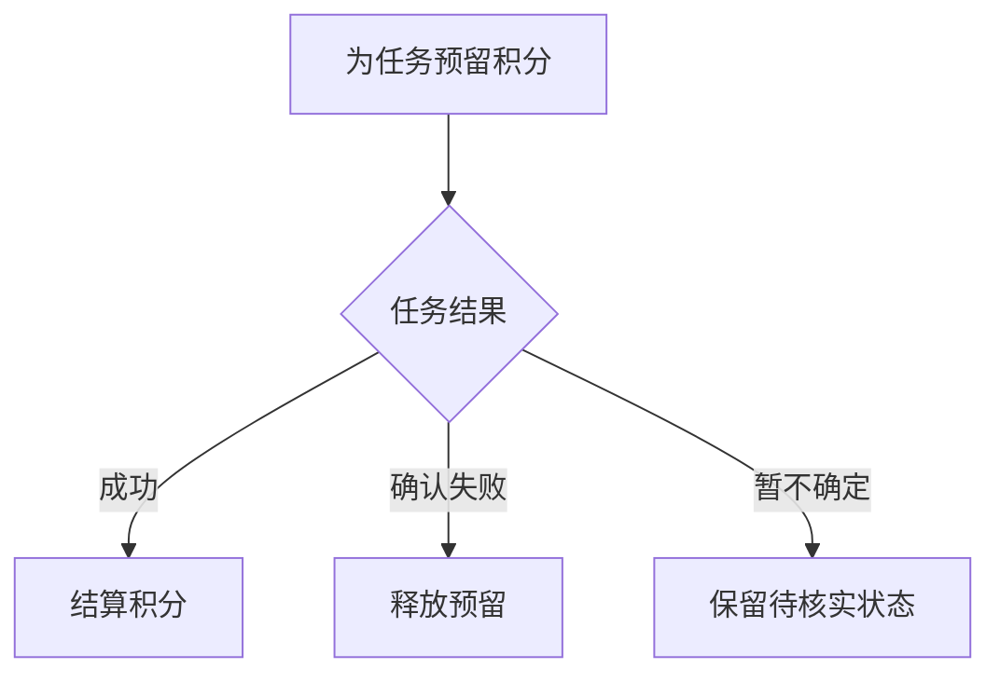
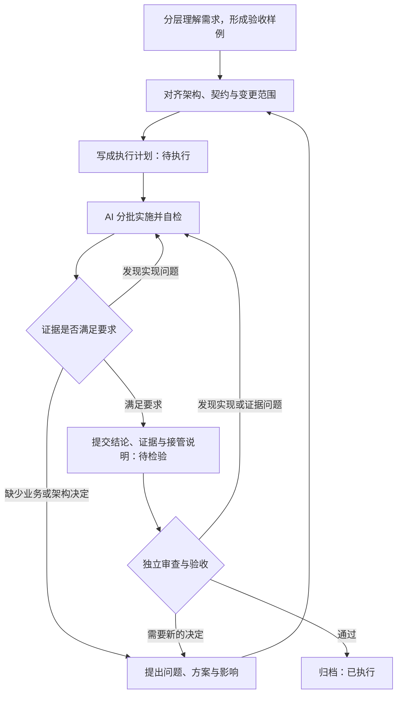

# 论 AI 对软件工程的影响与重构

**代码越来越容易生成之后，人如何继续掌控软件？**

> **三句话版本**
>
> 1. AI 降低的是“写代码”的成本，没有降低“弄懂系统”的成本。代码来得越快，需要人理解和拍板的东西也来得越快。
> 2. 所以真正要管的指标不是产出了多少代码，而是**代码掌控度**：出了问题，你能不能说清它为什么这样、该改哪里、怎么验证、怎么退回去。
> 3. 办法不是让人把 AI 写的每一行都读一遍，而是把人的注意力集中在少数几样东西上——流程、边界、契约、证据——其余交给 AI 在边界内自主完成。

## 摘要

AI 正在扩大软件开发中可以交给机器执行的工作范围，但实现速度的提升，不会自动变成更轻松、更可控的开发过程。当业务判断、架构协调和结果验证都集中到维护者一个人身上时，人的注意力就成了新的瓶颈。

本文以“代码掌控度”为核心，讨论 AI 怎样改变软件工程里的分工，并给出一套从需求到交付的协作方法：

- 需求按模块组织，按“总体流程—局部细节—整体约束”三层展开，并标明流程的每一步由谁推进；
- 业务规则和验收样例同步形成；
- 用架构基线、决策权分档和接口契约，划定 AI 可以自主的范围；
- 校验只为底线而设，失败必须分类、必须有出路；
- 测试按风险选择范围和环境，并事先约定停止条件；
- 用“待执行—待检验—已执行”的计划文档，把方案、执行和审查接成一条工作流；
- 用在制品上限、修复止损和降级演练，给“停不下来”装上刹车。

文章用“视频生成失败不扣积分”作为贯穿全文的设计示例，并穿插作者在一个真实项目中遇到的若干个案。其中 2.7 节记录了作者用 AI 开发约四个月的完整曲线：从体感十倍的提速和停不下来，到瓶颈期、维护地狱，再到离开高级模型就无法开发的困境。作者由此得出的判断是：维护难，是 AI 开发最大的问题。附录把正文的方法整理成 30 条带编号的规则和一组通用提示词，可以直接用来生成具体项目的工程提示词。

**关键词**：AI 编程；软件工程；代码掌控度；注意力；接口契约；需求与测试；工作流

## 目录

- [1 引言：一个“全部通过”的下午](#1-引言一个全部通过的下午)
- [2 先把账算清楚：AI 到底改变了什么](#2-先把账算清楚ai-到底改变了什么)
  - [2.1 代码写得快，项目就一定做得快吗](#21-代码写得快项目就一定做得快吗)
  - [2.2 AI 省掉的是哪一种“难”](#22-ai-省掉的是哪一种难)
  - [2.3 软件工程一直在解决“人和人怎么配合”](#23-软件工程一直在解决人和人怎么配合)
  - [2.4 程序真正的“本体”在人的脑子里](#24-程序真正的本体在人的脑子里)
  - [2.5 模块和接口：让人不必读完全部代码的老办法](#25-模块和接口让人不必读完全部代码的老办法)
  - [2.6 人的注意力，不能按机器的输入方式来安排](#26-人的注意力不能按机器的输入方式来安排)
  - [2.7 把账落到一个人身上：四个月，从十倍速到维护地狱](#27-把账落到一个人身上四个月从十倍速到维护地狱)
- [3 代码掌控度：它是什么，又是怎么丢的](#3-代码掌控度它是什么又是怎么丢的)
  - [3.1 掌控代码，就是你随时有办法接手](#31-掌控代码就是你随时有办法接手)
  - [3.2 掌控不等于全读：按风险分三档](#32-掌控不等于全读按风险分三档)
  - [3.3 为什么写得更少，反而想得更多](#33-为什么写得更少反而想得更多)
  - [3.4 掌控是怎么丢的：五种常见方式](#34-掌控是怎么丢的五种常见方式)
- [4 以代码掌控度为核心的人机协同方法](#4-以代码掌控度为核心的人机协同方法)
  - [4.0 先约定三个词：必须、应当、可以](#40-先约定三个词必须应当可以)
  - [4.1 需求：按模块拆开，按人的理解顺序展开](#41-需求按模块拆开按人的理解顺序展开)
  - [4.2 需求与测试：从讨论规则的那一刻就绑在一起](#42-需求与测试从讨论规则的那一刻就绑在一起)
  - [4.3 架构：先有边界，AI 才有自主空间](#43-架构先有边界ai-才有自主空间)
  - [4.4 契约：字段之外，还要约定含义、失败和变化](#44-契约字段之外还要约定含义失败和变化)
  - [4.5 校验与失败处理：少而准](#45-校验与失败处理少而准)
  - [4.6 测试：选对范围，知道何时停](#46-测试选对范围知道何时停)
  - [4.7 工作流：把方案、执行和审查接成一条线](#47-工作流把方案执行和审查接成一条线)
  - [4.8 节奏：给“停不下来”装三个刹车](#48-节奏给停不下来装三个刹车)
- [5 应用示例与评价设计](#5-应用示例与评价设计)
  - [5.1 新增一个服务商，怎样限制变化的范围](#51-新增一个服务商怎样限制变化的范围)
  - [5.2 一次交付，应该留下怎样的证据](#52-一次交付应该留下怎样的证据)
  - [5.3 这套方法有没有用，要怎样检验](#53-这套方法有没有用要怎样检验)
- [6 讨论](#6-讨论)
  - [6.1 约束的强度，要和项目的需要相称](#61-约束的强度要和项目的需要相称)
  - [6.2 文档、契约和测试，都有自己的盲区](#62-文档契约和测试都有自己的盲区)
  - [6.3 AI 更强以后，人还需要掌控吗](#63-ai-更强以后人还需要掌控吗)
- [7 结论](#7-结论)
- [参考文献](#参考文献)
- [附录 A 规则速查表](#附录-a-规则速查表)
  - [需求](#需求)
  - [架构与决策](#架构与决策)
  - [契约](#契约)
  - [校验与失败处理](#校验与失败处理)
  - [测试](#测试)
  - [工作流与交付](#工作流与交付)
  - [节奏与依赖](#节奏与依赖)
- [附录 B 通用提示词](#附录-b-通用提示词)
  - [B.0 怎么用](#b0-怎么用)
  - [B.1 生成项目工程提示词](#b1-生成项目工程提示词)
  - [B.2 入口文件骨架](#b2-入口文件骨架)
  - [B.3 需求梳理](#b3-需求梳理)
  - [B.4 编写执行计划](#b4-编写执行计划)
  - [B.5 按计划执行](#b5-按计划执行)
  - [B.6 审查与验收](#b6-审查与验收)
  - [B.7 故障排查](#b7-故障排查)

## 1 引言：一个“全部通过”的下午

设想这样一个场景。

你给 AI 提了一个需求：“用户生成视频，如果生成失败，就不要扣积分。”

AI 很快开始干活。它改了页面，补了接口，在后台加了一些状态判断，又给新逻辑写了测试。最后它告诉你：功能已完成，测试全部通过。

看起来是一次很顺利的协作。

可是当你打开代码，准备接着做下一个需求时，问题来了：

- 为什么积分逻辑出现在页面里？
- 为什么只是处理一个“失败”，任务模块和支付模块都被改了一遍？
- 那个原本只负责调用服务商的类，什么时候开始决定用户该不该扣费了？

还有一个更难回答的问题：如果明天有用户说“视频没出来，积分却没了”，你知道该从哪里查起吗？

这个场景里藏着一个值得认真对待的变化：**功能完成了，但维护者对功能的理解没有跟着增长。** AI 说“全部通过”的那一刻，可能恰恰是你最不了解这个项目的时刻。

一次这样的迭代没什么。十次、一百次之后，项目会一边变得越来越能干，一边变得越来越没人敢动。

软件工程本来就不只是写代码，它包含需求、设计、构建、测试和维护等一整串相互关联的活动。[1] AI 让其中“构建”这一环变得很便宜，也就逼着我们重新回答三个老问题：

- 谁负责理解整个系统？
- 谁有权决定它怎样变化？
- 拿什么证据证明变化是对的？

本文的核心判断是：**AI 时代的软件工程，要把人的“代码掌控度”当成一个需要持续维护的工程目标。** 人要能理解关键结构、解释重要行为、预判修改的影响，并在必要时把代码接过来自己改。守住这一点，AI 才能获得稳定而充分的自主空间；守不住，AI 的自主就只是在给未来攒麻烦。

打个比方。你请施工队装修房子，不必自己会砌墙，也不必盯着每一块砖。但你得知道承重墙是哪几面，水电管线怎么走，哪面墙后面埋着管子。否则几年以后想在墙上挂个电视，你连孔都不敢打。

代码掌控度，说的就是这张“水电图”还在不在你手里。

接下来文章依次讨论：AI 到底改变了哪些工作，以及作者自己四个月的经历（第 2 节）；掌控度是什么、通常是怎么丢的（第 3 节）；怎样通过需求、架构、契约、校验、测试和工作流把它守住（第 4 节）；这套方法怎样用、怎样检验（第 5 节）；它的局限在哪里（第 6 节）。赶时间的话，直接读 2.7 节、第 3 节和第 4 节。

文中的“人”可以是一个独立开发者，也可以是一支有明确分工的团队。本文不要求某一个人理解大型系统的全部细节，只要求每一块关键内容都有人能接手。

## 2 先把账算清楚：AI 到底改变了什么

### 2.1 代码写得快，项目就一定做得快吗

讨论 AI 编程，最容易盯着的是它能写多少代码、能解多难的题。这些能力当然重要。SWE-bench 把真实代码仓库里的问题和对应的修改放在一起做评测，说明评价 AI 编程能力的尺度已经从“写一个函数”扩大到“修一个仓库里的问题”。[2]

但是，“一个系统能解某类编程题”和“一个团队因此做得更快更稳”，是两件需要分别验证的事。

先看一项结果偏正面的研究。一项面向 95 名开发者的随机实验，要求参与者用 JavaScript 实现一个 HTTP 服务。在完成任务的参与者中，使用 GitHub Copilot 的一组平均用时少了 55.8%。[3] 这是特定任务上很显著的收益，不过它测的是一个边界清楚的小任务，没有测一个产品从需求讨论到长期维护的全过程。

再看一项结果相反的研究。METR 找了 16 名熟悉各自开源项目的开发者，处理 246 个真实任务。结果是：在 2025 年初的工具和工作条件下，允许使用 AI 的任务，平均耗时反而多了约 19%。[4] 到了 2026 年，METR 在后续更新里说，新的观察出现了加速的迹象，但参与者的选择、报酬安排、并行工作怎么计时等问题，让他们没法据此给出一个可靠的“当前总体收益”。[5]

两项研究并不矛盾。它们提醒我们，说“快”之前要先说清楚五件事：是谁，在什么项目里，用什么工具，做的是哪一段工作，最后怎么确认质量。

- 面对一个陌生的小任务，AI 可以帮人迅速跨过“不知道怎么写”的门槛。
- 面对一个自己非常熟悉、历史包袱很多的项目，读 AI 的产出、纠正它的偏差、给它补上下文，本身就要花不少时间。

所以本文关心的是一笔更完整的账：**写代码省下来的时间，够不够支付理解需求、解释上下文、审查变更、跑测试和日后维护多出来的时间。** 只有把这些一起算进去，才知道开发到底有没有变轻松。

这就像开车。油门踩得再狠，方向要是错了，只会更快地到达错误的地方，然后再花时间开回来。车速表上的数字，和“几点能到家”是两回事。

### 2.2 AI 省掉的是哪一种“难”

1987 年，Brooks 在《没有银弹》里把软件开发的困难分成两种。[6]

- **本质困难**：想清楚到底要造什么——系统里有哪些概念，它们之间是什么关系，各种情况下该怎么办。
- **附属困难**：把已经想清楚的东西表达成能运行的代码时遇到的麻烦——语法、工具、环境、重复劳动。

放到装修里：砌墙、贴砖、走线，是附属困难，累，但请人就能解决。户型怎么改、厨房要不要做开放式，是本质困难，请多少人都得你自己定。

Brooks 的判断是：以往的重大进步，消除的大多是附属困难；只要本质困难还占大头，光靠消除附属困难，就换不来数量级的提升。

用这个框架看今天的 AI 编程：AI 压缩得最明显的，正是附属困难。样板代码、接口对接、格式转换、查文档，这些过去要花半天的事，现在几分钟就有结果。

本质困难呢？AI 也能帮上忙——它可以列出你没想到的情况，给出几种方案的比较。但“失败到底怎么算”“这笔积分该不该退”“这一步要不要用户确认”，最后拍板的还是人。

AI 相当于一支不要工钱、一天能干完一个月活的施工队。墙一上午就砌好了，然后工头站在客厅中间问你：厨房到底要不要做开放式？

这就解释了一个常见的体感：**以前一天里大部分时间在“写”，偶尔停下来“想”；现在几乎每时每刻都在“想”。** 附属困难被拿走以后，剩下的全是硬骨头，而且因为代码来得快，硬骨头来得也快。

### 2.3 软件工程一直在解决“人和人怎么配合”

在分工成熟的团队里，业务知识分散在不同角色手里。产品经理解释用户要什么，架构负责人守着系统边界，开发者实现模块，测试人员检查预期和实际的差距。没有人需要独自做完所有判断。

Conway 在 1968 年观察到，系统被设计成什么样子，和设计它的那群人怎样沟通有关。[7] 借这个视角可以追问一句：当团队里一部分成员换成了 AI，原来的配合方式还能照搬吗？

设想一个开发者同时让 AI 写前端、写后端、写数据库迁移、写测试。原来要几个人分头干的活，确实可以由一个人集中推进了。可是：

- 前端和后端对同一个状态理解不一致，谁来裁决？
- 数据能不能丢、失败要不要补偿，谁来决定？
- 接口字段的含义，谁来统一？

过去这些问题会在几个人的讨论中自然暴露——后端同事会问前端同事“你这个状态是什么意思”。现在几个“同事”都是 AI，各自只做手头的任务，通常不会像同事那样互相追问。这有点像装修时水电工、瓦工、木工互不见面：每个人都把自己那部分干得很漂亮，只是没有人问一句“你的水管从哪儿过”。以前中间有个项目经理负责协调，现在项目经理是你。

这是本文对“AI 重构软件工程”的第一个判断：**执行工作集中了，协调工作并不会跟着消失，它只是更集中地压到了一个人头上。** 一个人借助 AI 扮演的角色越多，就越需要一套工作流来帮他管住这些判断。

### 2.4 程序真正的“本体”在人的脑子里

1985 年，Naur 写过一篇很有意思的文章，标题是《编程即理论构建》。[8] 他的观点是：编程最重要的产物不是程序文本，而是程序员脑子里的一套理解——这个程序怎样对应现实里的事务，为什么设计成这样，来了新需求该从哪里下手。他把这套理解称为“理论”。

按 Naur 的说法，代码和文档都只是这套理论的不完整记录。掌握理论的人离开以后，程序哪怕还在运行，也很难再被恰当地修改。

好比一家餐馆，招牌菜的菜谱一直贴在后厨墙上，会做这道菜的厨师却走了。新来的人照着菜谱也能做出来，可是客人说“少放辣、换成鸡肉”的时候，他不知道哪一步能动，哪一步一动整道菜就毁了。

把这个观点放到 AI 编程里，结论有点让人不安：如果代码是 AI 写的，而人没有同步建立起对应的理解，那么**这个程序从诞生那天起，就处在“掌握理论的人已经离开”的状态。** 菜谱是新的，厨师却从来没有来上过班。

另一篇 1983 年的经典文章《自动化的讽刺》，讲的是工业控制，但放在今天同样贴切。[9] Bainbridge 指出，自动化往往把容易的部分拿走，把机器处理不了的困难部分留给人；而人因为平时不再亲手操作，技能会退化，恰恰在最需要接管的异常时刻，接管能力最弱。

想想自动驾驶。一路上都是车自己开，偏偏到了最复杂的那个路口，它“叮”的一声把方向盘还给你——而你已经半年没有自己开过车了。

这对 AI 编程是一个直接的提醒：**“出了事人再接手”不是一个免费的保底方案。接手的能力需要平时维持。** 如果日常开发中人从不深入代码，等到线上出问题、AI 又连续几轮修不好的时候，人面对的将是一个自己从没真正读懂过的系统。

### 2.5 模块和接口：让人不必读完全部代码的老办法

好消息是，软件工程早就有一套办法，让人不必读懂全部代码也能掌控系统。

Parnas 讨论模块划分时强调，模块的边界应该围绕“需要隐藏的设计决策”来划。[10] 意思是，模块的价值不在于把文件放进不同的目录，而在于让一部分变化留在模块内部，外面的人不用跟着理解、跟着改。

拿餐馆的菜单来说。我在菜单上点一份西红柿炒蛋，等一会儿，就能得到一盘西红柿炒蛋。我不需要知道这道菜是怎么炒出来的，不需要知道西红柿是新西兰的还是奥尔本的，更不需要知道下蛋的那只鸡有没有童年阴影。

菜单就是接口，后厨就是模块内部。后厨换了供应商、换了厨师，只要端出来的还是那盘西红柿炒蛋，菜单就不用重印，客人也不用重新学怎么点菜。

放回代码里也一样：某个外部服务商改了签名算法，只需要改接入它的那个模块。积分模块只关心“任务有没有可靠的结果”，不需要知道签名字符串是怎么拼出来的。

Meyer 的契约式设计则把调用双方的责任说得更明白：调用之前要满足什么条件，完成之后保证什么结果，哪些约束在任何时候都必须成立。[11]

这两个思想对 AI 协作正好有用。清楚的模块边界，缩小了一次任务需要理解的范围；明确的契约，让人和 AI 对“做对了”有同一个标准。

由此可以得到一种分工：**人盯住模块职责、接口语义和关键约束；AI 负责边界以内的实现。** 人仍然保留钻进代码的能力，但不必为了弄懂一个功能，先把整个项目重读一遍。

### 2.6 人的注意力，不能按机器的输入方式来安排

AI 可以一口气生成一篇长说明、一张完整的时序图和一大堆测试结果。这些内容对人有没有用，要看它们是怎样摆到人面前的。

Simon 很早就指出，信息丰富的地方，稀缺的是注意力——信息会消耗接收者的注意力。[12] 认知负荷方面的研究也提示，人在解决问题时，要同时记住当前状态、目标和若干中间步骤，这会占用有限的认知资源；已有的知识和任务的组织方式，会影响负担的大小。[13]

这解释了一种很常见的阅读体验：每句话都看得懂，整张图却要来回看好几遍，才明白它到底在说什么。

人们喜欢说“人的 token 窗口也是有限的”。这是个好懂的比喻，但严格说，人并没有一个能换算成模型 token 数的固定窗口。更实际的问题是：**在当前任务和已有知识下，读者需要同时记住多少个状态、多少种关系、多少个还没解决的问题。**

所以，“写短一点”只解决了一半问题。一个很短、却省掉了关键因果关系的回答，可能让人更累，因为读者得自己把缺的那一环补出来。好的表达是先帮人搭起整体框架，再一步步往里填细节。

Shneiderman 在信息可视化研究里提出过一条著名的原则：先看总览，再缩放和筛选，细节按需查看。[14] 本文在需求协作中采用的“总体流程—局部细节—整体约束”三段式表达，就是从它来的。

### 2.7 把账落到一个人身上：四个月，从十倍速到维护地狱

前面几节讲的是研究和理论。这一节换个角度，讲作者自己用 Codex 和 Claude 开发大约四个月的经历。

四个月，四个阶段，一条先冲上天、再掉下来的曲线。每个阶段背后，都有研究数据可以对照。

| 阶段         | 体感速度                       | 人在做什么                                    |
| ------------ | ------------------------------ | --------------------------------------------- |
| 一、狂飙     | 原来的 10 倍以上               | 不断加需求、开新线，停不下来                  |
| 二、瓶颈     | 开始变慢，说不清为什么         | 更用力地用 AI：更多轮次，更长的提示，更多规则 |
| 三、维护地狱 | 降到高峰期的一半左右，有时更低 | 大部分时间在调试和修问题，而不是做新东西      |
| 四、模型依赖 | 取决于手里是什么模型           | 离开最高一档的模型，项目就推不动              |

#### 第一阶段：十倍速，以及停不下来

头一两个月的感受只能用“疯狂”来形容。原来要做一个月的东西，几天就出来了。没掐过表，但体感上，速度是原来的十倍以上。

随之而来的是三种“停不下来”。

- **需求越加越多。** 以前一个想法要掂量半天值不值得做，现在一句话就能开工。做的成本降下来以后，“要不要做”的门槛也跟着塌了。
- **同时开很多条线。** AI 干活的时候人是空闲的，于是再开一条线，再开一个项目。到后来，人不再是开发者，而是几条线之间的调度员，来回切换着回答每一个 AI 的问题。
- **总想再试一轮。** 结果差一点不对，再说一句话让它改；还差一点，再来一轮。每一轮的成本只是一句话，结果却不确定——有时一次就好，有时十次都不好。这种“差一点就成了”的感觉，让人很难主动停手。像极了商场里的抓娃娃机：爪子明明已经碰到了，再投一个币，肯定能抓上来。

这一阶段最需要警惕的，恰恰是“感觉很快”本身。前面提到的 METR 实验里有一组容易被忽略的数字：开发者在开始前预计 AI 能让自己快 24%；做完以后，他们仍然认为自己快了 20%；而实际测量的结果是慢了 19%。[4] 人对自己速度的感觉，和实际速度可以差出一个方向。

十倍速的感觉是真的。项目有没有以十倍的速度接近完成，是另一回事。

这很像刷信用卡。刷的时候没有任何痛感，东西立刻到手，账单要过一阵子才寄来。

**这个阶段产出的不只是功能，还有一大批没有人真正读过的代码。账已经记下了，只是还没到还的时候。**

#### 第二阶段：瓶颈期，越用力越慢

不知道从哪一天开始，事情变了味。

- 同样大小的需求，花的时间越来越长。
- AI 开始“改一处，坏一处”。
- 每次交代任务，要补充的背景越来越多。
- 每出一次事故，就给 AI 加一条规则。

> **项目观察**
> 作者的工程里，约束 AI 的规则文件已经有 19 份、三千多行。每一条都是某次事故之后补上的，每一条单独看都有道理。但规则本身也成了需要维护的东西：它们之间会重复、会冲突，模型也不一定每次都读全、照做。

瓶颈期真正的困境，是眼前的两条路都不好走。

- **停下来整理。** 可是代码不是自己写的，读不懂，不知道从哪里整理起；而且一停下来，眼前的进度立刻变慢。
- **继续加功能。** 每加一个，牵动的旧代码就多一些，下一个只会更慢。

多数时候，人会不自觉地选第三条路：更用力地用 AI。多试几轮，把提示写得更长，再加几条规则。这条路在短期内总能挤出一点进展，所以很难意识到它在加重问题。就像车陷进泥里以后猛踩油门：轮子转得飞快，车却越陷越深。

这种“个人觉得快，整体却没有变快”的现象，在大样本调查里也有迹象。2024 年的 DORA 报告基于问卷数据估计：AI 采用程度每提高 25%，文档质量约提升 7.5%，代码质量约提升 3.4%，代码评审速度约提升 3.1%；但随着 AI 采用程度提高，软件交付的吞吐量估计下降约 1.5%，交付稳定性估计下降约 7.2%。[15] 这是问卷数据里的相关性，方向和上面的体感一致：局部环节变快，不等于整条交付链变快、变稳。

用 2.2 节的话说：附属困难被拿走以后，本质困难并没有消失，它只是攒了起来。瓶颈期就是它开始讨账的时候。

#### 第三阶段：维护地狱

到第四个月，同样大小的需求，速度大约只有高峰期的一半，有时还要更低：以前半天就能完成的功能，现在光是调试就要花上三天。

更要命的变化不在速度，而在时间花在了哪里：大部分时间不是在做新东西，而是在调试和修问题。

> **项目观察**
> 某一天，作者只是想把一条主流程从头到尾走通一遍，先后撞上了这些问题：几个后台任务卡在同一步出不来；中间结果生成完，没等用户确认就跳到了下一个页面；客户端里一条旧缓存拦住了新建流程；一次内容分析因为多了一个换行而失败；失败提示既不说是哪一部分出了问题，也不说该怎么改。它们分属后端、客户端、提示词和校验规则，每一个单独拿出来都不难修。难的是它们同时存在，而且没有一个是作者能直接看着代码判断的。

维护地狱有三个特征。

1. **修一个，冒两个。** 修改所在的模块没有清楚的边界，任何改动都可能碰到别处的隐含假设。
2. **同一个问题换个样子回来。** 因为同一条规则写在了好几个地方，只修了其中一处。
3. **分不清 AI 的诊断是真是假。** AI 给出一个听上去很合理的原因，人没有能力验证，只能再找另一个 AI 来审。

代码层面也有数据可以对照。GitClear 分析了 2020 到 2024 年间约 2.11 亿行代码变更，报告说：复制粘贴的代码行占比从 2021 年的 8.3% 上升到 2024 年的 12.3%；被“移动”的代码行（通常意味着重构和复用）占比，从 2021 年的 25% 降到 2024 年的不足 10%；复制粘贴的比例第一次超过了移动。[16] 这组数据记录的是 AI 编程工具普及这几年的整体趋势。趋势的方向——新增和复制变多，整理和复用变少——正是“修一个冒两个”的土壤。

回到 2.4 节 Naur 的说法：这时候项目的“理论”不在任何人的脑子里。代码还在跑，但没有人能有把握地改它。

用引言里装修的比方说：房子已经住进去了，水电图却没有人留着。想在墙上打一个孔，谁也不敢下手。

#### 第四阶段：离开高级模型就做不动

最后一个困境来得最隐蔽：项目变得只有最高一档的模型才维护得了。

作者遇到的是四种情况叠在一起。

1. **便宜的模型越改越乱。** 代码和规则复杂到一定程度以后，普通模型理解不了全貌，改一处坏几处。
2. **规则太长，小模型不照做。** 为了管住 AI 而写的几千行规则，反过来要求模型有足够的能力读完并遵守。
3. **自己读不懂代码了。** 代码都是 AI 写的，出了问题只能靠高级模型来查。
4. **额度和费用撑不住。** 高级模型的额度很快用完，用完就只能停工，或者换成一个会把事情弄乱的模型。

这四件事连成了一个闭环：越读不懂，越依赖模型；越依赖模型，越没有机会读懂。

像一个离不开导航的司机：越依赖导航，越不记路；越不记路，越离不开导航。偏偏这个导航还是按次收费的，每天有次数上限，用完了就把你扔在半路。

这正是 2.4 节“自动化的讽刺”在个人身上的版本。[9] 关于“读懂”的那一环，也有实验可以对照。Anthropic 的研究者做过一项随机实验，让 52 名（多数是初级的）软件工程师学习使用一个陌生的 Python 库：使用 AI 辅助的一组，在随后的理解测验中平均得分约 50%，手写代码的一组约 67%，差异在统计上显著（p = 0.01）；而两组完成任务的时间只差两分钟左右（约 23 分钟对 25 分钟），统计上并不显著（p = 0.391）。[17] 这是在一次短任务里测出来的学习效果，它指向的是同一个方向：把理解的过程交给 AI，省下的时间有限，付出的理解代价是实在的。

从工程的角度看，这是一种新的依赖。过去依赖一个第三方库，出了问题至少可以去读它的源码。现在依赖的是一种“能力”——它有价格、有额度、会升级也会变化，而项目能不能继续维护，全系在它身上。

#### 这条曲线说明了什么

回头看，头两个月的十倍速，有一部分是借来的。借的东西叫“理解”：功能做出来了，人对功能的理解没有跟上。后面两个月的减速，是在连本带利地还。

四个阶段的问题，根子都能在后文找到对应的对策。

| 阶段     | 根子上的问题                                   | 对应的方法                         |
| -------- | ---------------------------------------------- | ---------------------------------- |
| 停不下来 | 产出的速度超过了人验收和理解的速度             | 4.8 节的在制品上限和修复止损       |
| 瓶颈     | 没有边界和唯一出处，每次改动牵动的范围越来越大 | 4.3 节的架构基线，4.4 节的契约     |
| 维护地狱 | 校验过多、失败沉默、测试只给实现作证           | 3.4 节的五种漏法，4.5、4.6 节      |
| 模型依赖 | 理解项目的成本，只有最高一档的模型付得起       | 3.2 节的三档掌控，4.8 节的降级演练 |

如果只能从这四个月里带走一句话，作者的判断是：**维护难，是 AI 开发最大的问题。** 写出来从来不是难点，难的是四个月以后还改得动。

本文的方法，就是从这四个月里一条一条总结出来的。

## 3 代码掌控度：它是什么，又是怎么丢的

### 3.1 掌控代码，就是你随时有办法接手

一个项目还在不在人的掌控之中，可以用四件很实际的事来判断：

- **知道结构。** 主要模块各管什么，数据归谁，谁可以调用谁。
- **能够解释。** 一个关键行为为什么会发生；正常、失败、重复操作时分别怎么处理。
- **能够预判。** 改一条规则会影响哪里，哪些接口和测试要一起检查。
- **能够接管。** 出了问题能定位、能修改、能验证，必要时能退回去。

本文用“代码掌控度”来概括这四种能力。它不要求维护者记住每个函数，也不要求每一行代码都由人亲手写。

要警惕的是另一种状态：维护者只知道“这个功能现在能用”，却不知道它为什么能用。一旦出问题，唯一的办法是把问题再丢回给 AI，指望下一轮能修好。

这就像家里的路由器。能上网的时候没人关心它是怎么工作的；一断网，唯一会的操作就是拔掉电源，再插上。

这样的项目不一定马上出事，但人已经失去了独立判断的余地。一个局部失误，很容易拖成一轮又一轮说不清原因的修改。

掌控度听起来有点虚，其实可以用五个问题来检查。本文把它们叫作**接管五问**，建议每次交付之后都问一遍：

1. 这条业务规则写在哪里？是不是只有一处？
2. 如果要改它，会动到哪些模块、接口和测试？
3. 用户投诉相关问题时，从哪里开始查？看哪些日志或数据？
4. 这次改动怎么撤回？撤回会丢掉什么？
5. 哪些情况没有验证？为什么可以接受？

五个问题里只要有一个答不上来，这次交付就还没有真正完成——不管测试是不是全绿。

### 3.2 掌控不等于全读：按风险分三档

一个现实的问题是：AI 一天能写几千行，人不可能都读。那“掌控”到底要读到什么程度？

本文建议按“出错的代价”和“能不能重做”把代码分成三档，分别对待。

| 档位           | 通常包括                                                     | 人要做到什么                                             |
| -------------- | ------------------------------------------------------------ | -------------------------------------------------------- |
| **必须读懂**   | 钱和账务、权限、用户数据的写入与删除、流程状态的流转、跨模块和对外的契约、数据库结构变更 | 读过实现，或者逐条核对过证据；能独立修改                 |
| **知道边界**   | 模块内部的实现、适配器、数据转换                             | 知道它的职责、输入输出、失败时的表现；出了问题能定位到它 |
| **可以当黑盒** | 界面样式、一次性脚本、样板代码、随时可以重新生成的部分       | 知道它存在、在哪里；坏了可以重做                         |

还是用装修来对应。承重墙和水电管线是第一档，动之前必须自己看过图纸。隔断墙怎么砌是第二档，知道它在哪里、隔开了什么就够了。墙面刷什么漆是第三档，不满意重刷一遍就是。

分档的依据是风险，不是代码量。一个二十行的积分结算函数属于第一档，一个两千行的页面布局可能属于第三档。

这张表的作用，是给“人不必读全部代码”这句话加上一个明确的下限。第一档的内容，无论 AI 多么自信地说“已完成”，人都要亲自确认；第三档的内容，人可以放心不看。**注意力是有预算的，掌控度管理就是把预算花在第一档上。**

具体哪些内容属于第一档，每个项目不同，应该写进项目的规则文件里，让 AI 在动到这些内容时主动提醒。

### 3.3 为什么写得更少，反而想得更多

代码生成变快以后，人的工作并没有消失，而是换了位置。以前你是掌勺的厨师，现在你成了出菜口的质检员：菜出得飞快，可每一盘都得你尝过才能端出去。

过去要花半天写的实现，现在几分钟就出现在眼前。与此同时，维护者要判断的事情多了起来：需求有没有被误解？几份文档是不是一致？前后端认的是不是同一种业务状态？新加的测试是在验证规则，还是只是把实现重复了一遍？

如果 AI 只管不断提交更多结果，却不帮人整理这些判断，那么省下来的敲键盘时间，会被新增的阅读和协调时间吃掉。

所以不能从“人不写代码了”直接推出“人轻松了”。要检查的是：**哪些工作真的消失了，哪些工作只是换了个地方。**

这也说明了为什么“让人全面评审 AI 写的代码”成不了唯一的办法。代码量持续增加时，把所有结果都推到同一个人面前，只是把瓶颈挪到了最后一道工序。

更合理的安排是反过来：先让需求、边界和验收依据清楚，再让 AI 自动完成范围内的检查，只把关键决策和高风险修改交给人。

### 3.4 掌控是怎么丢的：五种常见方式

掌控度很少是一次丢光的，通常是一点一点漏掉的。结合作者的项目经历，常见的有五种漏法。

#### 第一种：边界在实现过程中悄悄移动

AI 工作时间长，不一定意味着失控。真正要观察的是：随着任务推进，它是不是改了越来越多的模块，重新解释了原有的接口，或者把没确认过的业务假设写进了实现。

“视频生成失败不扣积分”本来是一条业务规则。如果 AI 为了尽快做完，让客户端来判断要不要退款，又让服务商适配器直接改余额，功能也许能跑通，但职责已经变了。这相当于施工队为了走线方便，顺手在承重墙上开了个洞，然后告诉你：“线走好了。”

下一个服务商接入时，这些规则会被再复制一遍。再下一个需求到来时，就没人说得清哪一处才是最终依据。

#### 第二种：测试在给实现“作证”

AI 写完实现，再根据实现写测试，测试自然全部通过。问题是，这样的测试验证的是“代码和代码自己一致”，不是“代码和业务一致”。相当于学生自己出题、自己答题、自己批卷，然后举着满分的卷子来报喜。

如果 AI 对需求的理解一开始就偏了，这个偏差会同时进入实现和测试。两者互相印证，看上去天衣无缝，业务却是错的。

#### 第三种：校验越写越多

这一种比较隐蔽，因为每一条校验单独看都“更安全”。好比给家门装了十二把锁。每多一把都“更安全”，结果是自己每天回家要开十分钟，哪天丢了一把钥匙，就彻底进不去了。

在作者的项目里，AI 写的代码常常用判断来证明自己没写错：前一步刚写进去的数据，后一步读出来再逐字段核对一遍；状态必须“正好是”某个值，否则就报错；模型返回的内容格式稍有出入，就整体作废。

这些判断挡不住任何真实的风险，却让流程变得很脆——任何一点和预期“稍有不同”的情况，都会让整个流程停下来。

> **项目观察**
> 有一个步骤是让 AI 模型把用户提交的长文本拆成若干片段，后端要求模型返回的“对应原文”必须和用户的文本逐字一致。有一次模型抄写原文时只是多加了一个换行，8 份文本里的 1 份就被整体判为失败，用户看到的是“解析失败”。事后清点，这一步共有 13 条“不对就整份失败”的检查，其中 10 条针对的是程序自己就能纠正的问题（多余的空白、序号的写法、数值略有出入等），真正需要判失败的只有 3 条。前面那 10 条一旦触发，用户什么也改不了，只能重试。

#### 第四种：一条规则，两个出处

同一条规则被写在两个地方，起初是一致的，改着改着就不一样了。AI 尤其容易制造这种重复，因为它每次任务看到的只是局部，不知道另一处已经有一份。这就像一套房子有两张水电图，电工看一张，水工看另一张。

> **项目观察**
> 有一条估算数值的规则同时存在于两个地方：给模型的提示词里写的是“这种情况按更大的值估算”，后端校验代码里写的是“乘以 1.5”。模型按自己的理解给了 8，校验算出来至少要 10。于是同一份输入，无论重试多少次，都卡在同一个位置上。

> **项目观察**
> 一个后处理任务的输入被精简成只保留“来源任务的编号”，而负责检查的另一个模块仍然从这份输入里读“内容类型”。读不到，就按默认类型处理，随后报错“缺少原结果”，7 个任务卡在了检查这一步。两个模块各自看都没错，错在它们对同一份数据的约定不一致。

#### 第五种：失败是沉默的

系统出了问题不可怕，可怕的是出了问题却看不出来，或者看出来了却不知道该怎么办。像一个没装电池的烟雾报警器：它一直很安静，你就以为一直很安全。

> **项目观察**
> 接着上面那个例子：结果保存阶段的代码把所有“未知异常”都当作临时故障来重试，并且没有次数上限。于是一个程序问题，变成了一段最长约 36 小时、没有任何报警的“处理中”。

> **项目观察**
> 分析失败时，界面最显眼的位置写的是“可能是网络波动或服务繁忙”，具体原因没有被保存下来。即使保存了，提示也是“第 19 个片段有问题”——可片段正是这一步要生成的东西，用户从来没见过它。用户既不知道是哪一部分出了问题，也不知道该改什么。

这五种漏法有一个共同点：**每一次单独看都不严重，甚至看起来是“认真负责”的表现。** 所以不能指望靠事后评审一条条抓出来，得把防线前移到需求、契约和规则里。这就是第 4 节要讲的内容。

## 4 以代码掌控度为核心的人机协同方法

### 4.0 先约定三个词：必须、应当、可以

这一节开始出现具体的规则。为了让规则的分量不产生歧义，本文参照 RFC 2119 的做法 [18]，约定三个词的含义：

| 用词                | 含义                                           |
| ------------------- | ---------------------------------------------- |
| **必须** / **不得** | 违反就算这次任务没有做对，没有例外             |
| **应当**            | 默认遵守；确有理由可以不遵守，但要把理由写出来 |
| **可以**            | 由执行者自行决定                               |

每条规则后面带一个编号，例如（R3），对应附录 A 规则表里的同一条。

### 4.1 需求：按模块拆开，按人的理解顺序展开

回到“视频生成失败不扣积分”。

这句话背后至少有四个职责：任务模块管理生成进度，积分模块负责预留和结算，服务商模块对接外部的生成能力，客户端把状态清楚地告诉用户。这里的“模块”指的是职责边界，是否部署成独立的服务，要看项目的实际需要。

梳理需求时，应当先给出这张简短的职责地图，再围绕这次的变化逐个进入相关模块（R1）。每个模块按三个层次展开；已经有共识的地方一句话带过，新增的或有争议的地方再细说（R2）。

#### 第一层：让人先看懂总体流程

以积分模块为例，先用一句话说清楚：

> 接受任务时先预留积分；生成成功后结算，确认失败后释放；暂时拿不到结果时，先核实任务状态。

这时读者只需要知道：积分为什么被预留，什么条件下才真正结算，失败之后会怎样。数据库字段、错误码、重试策略，现在一个都不用看。

这和看地图是一个道理：先看清自己在哪个城市、要去哪个区，再放大去找门牌号。一上来就给你看门牌号，你连自己在哪个省都不知道。



这张图留下了很多问题没回答，但它已经足够让读者有一个整体印象。后面的所有细节，都有地方可以挂上去。

总体流程里有一样东西特别容易漏掉，却特别重要：**每一步由谁来推进。**

一个流程往下走，无非三种推动方式：用户点了确认；系统自动进入下一步；外部事件到达（比如服务商的回调）。这三种在流程图上看起来都是一个箭头，对用户来说却是完全不同的体验。

楼梯和自动扶梯都能上楼，区别是：楼梯你不抬脚它不动，扶梯你一站上去它就走。用户以为自己走的是楼梯，脚下却是扶梯，一回神，人已经在三楼了。

> **项目观察**
> 作者的项目里，用户要走完一长串步骤才能拿到最终结果：提交内容、生成初稿、确认、设置参数、生成中间结果、再生成最终结果。AI 实现时，把“中间结果全部生成完”处理成了自动进入下一步。可是用户需要先看一眼中间结果合不合适，再决定要不要继续。类似的推进问题先后出现了几次，直到作者把整个流程写成一行、在每一步后面标上“用户确认”或“自动”，双方的理解才对上：整条流程里只有一步是自动进入的，其余都要用户确认。

所以，总体流程必须标明每一步的推进方：用户确认、系统自动，还是外部事件。没有标明推进方的步骤，AI 不得自行实现成自动推进，应当先问（R3）。

#### 第二层：一次弄清一组细节

现在只讨论积分模块最关键的几个问题。

- 预留的积分和已经扣掉的积分，界面上要不要区分？
- 用户连点两次“生成”，该创建几个任务？
- 服务商连着发了两次成功通知，会不会结算两次？
- 客户端等不到响应，能不能直接认定任务失败？

最后一个问题尤其重要。**客户端超时，只说明客户端没有及时拿到结果。** 在这个异步的例子里，服务端的任务可能还在跑，服务商也可能已经生成成功了。

如果把“没收到结果”直接写成“生成失败”，前端、后端和积分模块就可能对同一个任务做出互相矛盾的判断。

讨论需求时，这些问题要逐个说清楚，并且区分三类内容：现有实现里的事实、已经确认的规则、还没决定的问题。比如，长时间拿不到结果时积分最多预留多久、什么时候转人工核对，这是业务政策。AI 应当指出这里有个缺口，给出几个备选方案和各自的后果；它不得自己编一个政策写进代码（R4）。

#### 第三层：把细节放回整体，看它们能不能同时成立

每条局部规则单看都合理，合在一起却可能打架。

假设客户端超时后显示“失败”，积分模块已经把预留释放了，结果服务商稍后又通知“成功”。这时页面、任务、账务三方的说法就对不上了。

第三层要做的，就是把这些关联放回完整的流程里：客户端超时后怎样恢复查询；任务模块怎样确定最终状态；积分模块依据什么事件来结算或释放；遇到迟到的或互相矛盾的结果，由谁负责核对。

在这个例子里，重新整合后的约定可以是：

- 客户端只按服务端的任务状态展示结果，连接超时后恢复查询，不自己下结论；
- 任务模块负责确认结果，积分模块依据约定的事件结算或释放；
- 已经确定的最终状态发生冲突时，进入异常核对流程，不直接再扣一次。

这时再展开一张带关键异常分支的流程图或时序图。图上要突出的，是那些影响跨模块一致性的细节，以及它们互相制约的位置。字段清单和完整的错误码留在各自的文档里，需要时再去查。

第三层不得省略（R2）。前两层如果简化过头，而第三层又没把关键限制放回去，读者得到的会是一种“过于轻松”的理解，比不理解更危险。

**三段式的目的是让理解一步步形成，不是让人确认三次。** 很小的需求，一段话就能把三层都说完；复杂的需求，才需要让人在某一层多停一会儿。已经确定的事实和已经授权的决定，AI 可以直接往下做。

### 4.2 需求与测试：从讨论规则的那一刻就绑在一起

“失败不扣积分”是一种意图。要把它变成能实现的需求，还得回答：哪些状态算失败？扣费发生在什么时候？怎样判断同一次生成没有被重复收费？

仔细看，这几个问题同时也是测试要回答的问题。

所以在 AI 编程里，需求和测试应当同步形成：**每明确一条关键业务规则，就配上至少一个能判断它成不成立的具体情境**——初始条件是什么，做了什么操作，预期的业务结果是什么（R5）。不必一开始就写完所有自动化脚本，但验收的依据要和规则一起出现。

装修合同里只写“卫生间要做好防水”是没有用的。得写成：“蓄水两天，楼下天花板不渗水。”前一句是意图，后一句才验得了。

Cucumber 社区的 Example Mapping 方法，就是把用户故事、规则、具体例子和悬而未决的问题摆在一起讨论，为这种做法提供了现成的实践参考。[19] 本文借用的是它的组织方式，不要求项目采用某一种测试框架。

下面这张表是贯穿示例里一组拟采用的规则。真实项目里，它们需要由对业务负责的人确认。

| 需求规则                               | 怎样算做对了                                 | 必须追问的边界                                   |
| -------------------------------------- | -------------------------------------------- | ------------------------------------------------ |
| 同一次提交只创建一个任务、预留一次积分 | 重复提交得到同一个任务，预留记录没有增加     | 同一个请求标识带了不同参数怎么办；并发提交怎么办 |
| 一个任务成功后只结算一次               | 成功结果对应一次有效结算，重复通知不增加扣费 | 通知重复、乱序，或与查询结果冲突时怎么办         |
| 确认失败后释放预留的积分               | 任务没有产生扣费，预留金额恢复为可用         | 释放过程本身失败怎么办；迟到的成功怎么核对       |
| 暂时未知不能直接当作失败               | 用户可以继续查询，任务和账务都可追踪         | 长期未知的处理期限和补偿责任是什么               |

这张表的价值在于让争议提前暴露。代码一行还没写，人已经能看出来：“失败”的含义不清楚，“同一次提交”怎么识别还没定，长期未知的任务也没有处理政策。

回头看 3.4 节的第二种漏法：如果等实现做完，再让 AI 照着自己的代码生成测试，那些没确认过的假设就会同时进入实现和测试。

因此，测试的预期结果必须能追溯到已确认的业务规则、外部契约或独立确定的样例。实现细节可以帮忙设计测试的入口，但不得单独充当“正确答案”（R6）。

这种联系要双向维护。测试暴露了新的模糊情况，就回到需求里澄清；需求变了，就找出受影响的样例、接口和检查。需求说明和测试记录，是同一组业务事实的两种写法。

### 4.3 架构：先有边界，AI 才有自主空间

想让 AI 放手去做，先得告诉它哪些事可以自己说了算。

**在已有的项目里**，AI 必须先核对现有的代码和文档，确认模块职责、数据归属、依赖方向和可用的扩展点，然后再动手（R7）。资料和实现对不上的地方，要说明差异和影响，再判断它会不会妨碍当前任务。

**在新项目里**，AI 可以提出架构方案、比较利弊、帮忙搭起初始结构。但关键的选择需要由将来负责维护的人理解并决定，之后才能在此基础上展开实现。

这份“架构基线”可以很轻。小项目可能只需要一张模块图，加几条必须守住的规则。例如：

- 积分余额和账务记录只由积分模块维护。
- 任务模块负责推进任务状态，通过约定的接口调用积分能力。
- 服务商模块只报告外部结果，不决定用户扣不扣费。
- 客户端只展示业务状态，通过服务端接口提交操作和查询结果。

这份基线，就是引言里说的那张“水电图”。它不需要画出每一块砖，只需要标出哪些墙不能动、管线从哪里走。

基线明确以后，剩下的问题是：遇到具体的决定，AI 是自己做，还是来问人？本文建议把决策权分成三档（R8）。

| 档位         | 包括哪些决定                                                 | AI 怎么做                            |
| ------------ | ------------------------------------------------------------ | ------------------------------------ |
| **自主**     | 模块内部的类、函数、数据结构、局部实现方式；修复检查中发现的问题 | 直接做，不用问                       |
| **做完报告** | 为当前任务做的局部整理；补充测试；修正文档与实现不一致的地方 | 直接做，在交付时说明                 |
| **先问**     | 业务政策；模块职责；公共接口和对外契约；数据归属；依赖方向；数据库结构；不可逆的操作（删除数据、对外发送、涉及钱） | 停下受影响的部分，提出方案，等人决定 |

还是装修的比方。瓷砖怎么切、线管怎么固定，师傅自己定；换一种同档次的辅料，干完说一声；要砸墙、要改水电走向，必须先给业主打电话。

遇到“先问”的事项，AI 只暂停受影响的那一部分，其他独立的工作应当继续推进。提问时必须带上：为什么需要改、有没有不改的局部替代方案、影响范围、迁移办法、怎么验证、怎么退回（R9）。一个只说“这里需要确认”却不给方案的提问，等于把思考的工作又推回给人。

这样安排是为了两头都省心：AI 不必为每个小决定打断人，人也不必担心 AI 在自己不知道的时候改了系统的骨架。**人的介入被集中到真正需要人决定的地方。**

顺带说一下“最小必要变更”。它不能按改了多少行来衡量。把积分规则复制到两个地方，行数可能比整理出一个归属正确的规则入口更少，却留下了更难维护的重复。应当追求的是：在业务正确、前后一致、可维护的前提下，让无关的变化最少。不得为了少改几行而复制关键规则，或者把职责冲突藏起来（R11）。

### 4.4 契约：字段之外，还要约定含义、失败和变化

“人关注接口，AI 关注实现”——这句话要成立，得先把“接口”理解完整。

一个接口当然包括路径、参数、字段和返回值。OpenAPI 这类规范可以把这些描述得很清楚。[20] 但只有这些还不够。本文建议一份契约至少覆盖三层内容。

#### 第一层：含义

- “创建任务成功”，是指请求已受理，还是视频已生成？
- 同一个请求标识能不能重复提交？
- “处理中”和“结果未知”有什么区别？
- 界面上的积分，是可用余额、预留金额，还是已结算金额？

这就像朋友发来一句“我马上到”。字面上没有任何歧义，可他也许已经在楼下，也许刚刚起床。

这些含义没说清楚的话，前后端用着完全匹配的 JSON，也可能在向用户表达两件不同的事。

所以契约必须写明业务状态的含义、幂等规则、错误的含义和必须保持的不变量，不能只有字段（R12）。前后端围绕这份约定各自实现，测试再检查双方有没有遵守。在贯穿示例里，客户端可以展示费用和余额，但最终怎么结算，由服务端的账务规则说了算。

#### 第二层：失败

接口成功时返回什么，大家通常写得很认真；失败时怎么办，往往一笔带过。可是从用户的角度看，失败的那一刻才是最需要系统把话说清楚的时候。好的失败提示像一块路牌：“前方施工，请走左侧。”坏的失败提示像一堵突然出现的墙。

回头看 3.4 节的第五种漏法，问题都出在“失败”没有被当作契约的一部分。本文建议契约对每种失败回答三个问题（R13）：

1. **它属于哪一类？** 用户能改的（内容不合规、参数不完整）；临时故障（网络超时、服务繁忙）；程序问题（数据对不上、出现了不该有的状态）。三类的处理方式完全不同。
2. **用户的出路是什么？** 每一次拒绝都必须告诉用户下一步能做什么。不能出现死路——提示“请先完成某一步”，而那一步在当前状态下根本做不了。
3. **用户看得懂吗？** 给用户的信息必须使用用户见过的概念。告诉用户“第 3 段的这句话太长，请拆成两句”，而不是“第 19 个片段长度校验失败”。技术原因写进日志，不要拼进给用户的文案里。

#### 第三层：变化

契约不是一成不变的。后端加一个字段、改一个状态，另一头会怎样，也要事先约定。

> **项目观察**
> 后端给一个接口的返回数据加了两个进度字段。客户端对所有数据都做严格解析，包括存在本地的旧缓存。旧缓存里没有这两个字段，一解析就报错。结果是：用户新建一条记录之后，页面无法跳转——因为跳转之前要先更新本地的索引，而索引里有一条旧记录读不出来。一条过期的缓存，拦住了所有新建流程。

契约必须约定变化时的规则：新增字段要向后兼容；读取方对缺失的非关键字段要有默认值；缓存、快照这类冗余数据读不出来时，要回到源头重新取，不能直接走进错误分支（R14）。

#### 一条规则只能有一个出处

3.4 节的第四种漏法——同一条规则写在两处，然后各走各的——在契约层面的解法很简单：**一条规则只能有一个出处，其他地方引用它，不各写一份（R10）。**

上面那条估算规则，要么由后端算好交给模型，要么把完整算法写进提示词并让校验代码使用同一份定义，不能提示词里写“酌情加长”、代码里写“乘以 1.5”。

#### 用设计模式把变化收在局部

内部模块之间同样需要约定。任务模块调用生成能力时，面对的应该是统一的“提交、查询、结果”；具体某个服务商的签名方式、字段差异和错误映射，留在各自的实现里。

这时候适配器、策略这些设计模式就有了实际用处：它们把容易变的部分安排在一个明确的位置。新服务商只要能满足现有的能力契约，接入时主要是新增一个适配器和相应的配置，原有的任务流程不用动。

开放封闭原则讲的就是通过合适的扩展点来应对变化。[21] 在 AI 协作里，它还多了一层具体的好处：缩小一次局部需求牵动的范围，让维护者能预先知道代码会在哪里变。

模式也要克制。如果只有一个简单的分支，暂时看不出它会独立变化，就不必为了“架构完整”加上好几层抽象。判断一个设计合不合适，可以只问一句：它有没有让职责更清楚、让下一次变化更容易定位？

### 4.5 校验与失败处理：少而准

3.4 节的第三种漏法是校验太多。这一节给出本文建议的对策，核心只有一句话：**判断是为了保护用户和钱，不是为了证明代码自己没写错。**

#### 只为底线而拦截

只有下面六类情况，可以“不满足就拒绝”（R15）：

1. **钱**：冻结、结算、退回各只发生一次；付费能力只调用一次。
2. **权限**：只能读写自己的数据。
3. **用户内容**：不覆盖用户手动修改过的内容。
4. **审核与合规**：没通过审核的内容不展示、不交付。
5. **外部输入**：请求参数、上传的文件、第三方的回调。
6. **流程状态**：用户的操作必须从合法的状态发起。

不在这张清单里的判断，要么删掉，要么改成一条警告日志然后继续。具体清单每个项目可以调整，但必须是一张写下来的、有限的清单。

#### 不要复核自己刚写的数据

同一个流程里，前一步写入、后一步读出的数据，不要再逐字段比较“是否一致”。它防不住任何用户行为，代码一改，它就先坏。

幂等的写法也类似：用“做过就直接返回”，不要用“状态不是 X 就报错”（R16）。重复请求到达时，状态已经变了是正常现象，不是异常。

#### 能纠正的纠正，内容不可用才判失败

对模型和外部系统返回的内容，先分清两种情况（R17）：

- **可以直接纠正的**：多余的空白和空行、标点的全角半角、序号的写法、数值略微超出范围。
- **确实不可用的**：缺少内容、改写了原意、引用了不存在的东西。

就像收快递。箱子外面蹭脏了，擦一擦就行；里面的东西摔碎了，才需要拒收。

前一种由程序直接修正并留下日志，后一种才判失败。判断标准是一个很朴素的问题：**这个问题，用户改得了吗？** 如果用户除了点“重试”别无选择，而程序自己就能修，那就不该让它变成一次失败。

#### 重试要有理由、有上限

“过一会儿再打一次”只对占线有用。对方如果是空号，打一百次也还是空号。

重试只适用于临时故障，并且必须有次数或时间的上限。不得把“不认识的异常”一律当作临时故障（R18）。超过上限以后，要留下一条带任务编号、步骤和原因的错误日志，并让状态如实显示为“处理异常”，不能伪装成“处理中”。

### 4.6 测试：选对范围，知道何时停

测试很容易变成另一种注意力消耗。

一个功能刚改完，AI 跑了一次局部测试；补了一句无关的注释，又把所有检查重跑一遍；看到项目里有移动端，再启动模拟器；最后为了“保险”，还想在真机上完整走一遍流程。如果这些动作背后没有一个明确的问题，它们只是在不断增加等待时间。

测试之前要先回答：**这次修改带来了什么风险？什么样的证据足以说明这些风险被控制住了？**

这和体检一样。只是换了副眼镜，查一下视力就够了，没有必要再做一遍全身核磁。

#### 范围、环境、成本，是三件事

这里有个容易混淆的地方。Android 官方的测试文档分别讨论了测试的范围和运行环境：测试可以跑在本地、模拟设备或实体设备上，覆盖的范围可以是一条局部规则、几个模块的交互，或者一条完整路径。[22]

所以真机测试并不是排在“整体测试”后面的“最高一级”。一个很小的相机行为检查，可能必须用实体设备；一条完整的服务端业务链路，完全可以在没有手机的环境里验证。

把这几个维度分开以后，怎么选就清楚了（R20）。

| 这次改了什么             | 先取得什么证据                           | 什么时候扩大范围或换环境                                     |
| ------------------------ | ---------------------------------------- | ------------------------------------------------------------ |
| 积分计算或状态规则       | 正常、失败、边界和重复事件的规则检查     | 涉及持久化、事务或并发时，验证相关的数据库和模块交互         |
| 任务与积分之间的调用     | 双方的契约、状态衔接和受影响的业务路径   | 变化触及更多调用方或共享规则时，增加相应的回归               |
| 新增外部生成服务商       | 请求映射、结果解析、错误处理和适配器契约 | 真实的鉴权、回调或服务商行为无法用模拟证明时，补联调         |
| 客户端恢复查询或展示     | 任务身份的保留、状态映射和恢复后的行为   | 涉及生命周期、后台执行、媒体或平台差异时，增加相关环境的验证 |
| 权限、硬件或设备相关能力 | 对应平台的行为和异常路径                 | 涉及真实硬件或特定设备差异时，用相关真机取证                 |

Android 的测试策略文档建议，选择测试范围时要综合考虑反馈质量、耗时、基础设施和稳定性，具体功能也不必机械地覆盖所有测试类别。[23] 本文据此提出的做法是：**先选能回答当前问题的最小充分范围，再根据还没覆盖到的风险扩大验证。**

范围小不代表要求低。比如幂等性，不能只检查“调用两次都没报错”，还要检查有没有多建任务、多预留积分、多做一次结算。如果风险来自并发，顺序调用两次通过，也证明不了并发时是对的。

契约测试也有自己的边界。它检查的是调用双方的交互约定，完整的业务规则仍然需要功能检查。[24] 接口格式符合约定，不等于积分算对了。

#### 执行前先写一个简短的测试计划

开始执行之前，AI 应当简要列出（R19）：这次要验证哪些风险；最小充分的范围是什么；需要什么环境；什么算成功；什么时候停。任务进行中发现了新风险，可以补充计划，不必为了遵守最初的清单而无视新事实。

#### 约定停止条件

满足下面四条，就应当停止额外的重跑（R21）：

- 需求里约定的关键样例和这次修改涉及的风险，都有了适用的证据。
- 出现过的失败已经处理，受影响的部分重新验证过。
- 项目要求的合并、发布检查已经满足。
- 没有新的相关修改、没解释清楚的失败，或需要补充的证据缺口。

如果预算用完了、环境不可用，或者结果仍有疑点，必须明确标出哪些没验证、影响是什么。**没有执行的检查不得写成“通过”；不得通过放宽断言，或者反复重跑到碰巧通过，来制造“通过”的结果。**

#### 旧结果可以复用，但要先核对

已有的测试结果可以复用，前提是它仍然适用（R22）。只看“提交号没变”是不够的：需求和测试的定义、实际的构建产物、依赖、配置、服务端版本、数据和运行环境，都可能改变结果的含义。只需核对和结论有关的因素，不必把所有无关的变化都当成重跑的理由。

性能、可靠性或偶发问题，可能需要有计划地重复测量，这种重复有明确的目的。而对一次原因不明的失败，不能一直跑到它碰巧通过，就宣布问题消失了。体温计量出 38 度，不能一直量到出现 36.8 度的那一次才算数。

### 4.7 工作流：把方案、执行和审查接成一条线

前面的原则可以收束成一条带反馈的工作流。



#### 计划文档：一份文件，三种状态

人和 AI 之间交接工作，靠的是计划文档。本文建议每份计划只处于三种状态之一（R23）：

| 状态       | 含义                           | 谁来推动       |
| ---------- | ------------------------------ | -------------- |
| **待执行** | 方案已确认，还没开始做         | 交给执行的 AI  |
| **待检验** | 已经做完并自检，等待审查和验收 | 交给审查者和人 |
| **已执行** | 验收通过，作为记录归档         | 不再改动       |

一份计划应当写在一个文件里，把要做的事分成几个批次，每个批次都写明：改哪些地方、不许碰什么、做完怎样算合格。计划是写给“一个不了解前因后果的执行者”看的，所以文件路径、接口名称、判断条件都要写具体，不能写“按之前讨论的方式处理”。

状态要写在文档最上面。这件小事的作用比想象中大：维护者打开文件夹，一眼就知道哪份该交给 AI 去做，哪份该自己去验收，哪份可以不管。

#### 批内连续做，只在该停的地方停

执行的 AI 应当把一个批次连续做完再汇报，不要做一点停一下（R24）。只有三种情况需要中途停下：遇到了 4.3 节的“先问”事项；发现继续做会碰到 4.5 节的底线（钱、权限、用户数据）；出现了补不上的证据缺口。

频繁的“我完成了第一步，是否继续？”看起来很谨慎，实际上是把注意力成本转嫁给了人。这就像一位每拧一颗螺丝都要给业主打一次电话的师傅。**该停的地方由规则事先定好，其余时间 AI 应该一直往前做。**

#### 审查要独立于执行

同一个 AI 既写需求说明，又写实现，还写测试，很可能把同一个错误假设贯穿到底。让施工队自己给自己验收，结论通常是“合格”。

本文建议把“出方案和审查”与“执行”分开——可以是两个不同的 AI，也可以是同一个 AI 的两次独立会话。审查方不应当以执行方的总结为依据，而应当自己去读代码、读日志、读测试结果（R25）。执行方说“已完成”是一个待核实的说法，不是证据。

人在这里的角色，是按 3.2 节的分档去核对第一档的内容，并回答接管五问。

#### 交付：先给结论，再给索引

最后一次交付应当先说结论（R26）：业务上做成了什么；改了哪些范围；契约和架构有没有变；有哪些验证证据；还有什么没做完。差异、日志和文档作为索引放在后面，人需要时再点进去看。

交付的文件应当尽量少，并且说清楚哪一份是需要人看的。十份文件摆在面前，人首先要花力气分辨哪些重要，这本身就是一种注意力损耗。

交付里还必须包含接管五问的答案（R27）：规则在哪、改它会动到哪、出问题从哪查、怎么撤回、哪些没验证。

这样，人读到的是一组组织好的判断依据，需要时可以继续往下钻。代码、文档和测试，共同服务于同一个目标：让人随时接得住。

### 4.8 节奏：给“停不下来”装三个刹车

2.7 节的经历说明，AI 协作里最不缺的就是油门。AI 不会累，也不会说“今天先到这里”。刹车只能由工作流来提供。本文建议三个。

#### 刹车一：没验收完，不开新线

AI 的产能近乎无限，人的验收能力却是有限的。做完了但没验收的工作，像仓库里的库存：看起来是资产，其实是负债。它随时可能被证明是错的，而且放得越久，越没人记得它当初为什么这样做。

所以，处于“待检验”状态的计划应当有数量上限，达到上限就先验收，不再启动新的计划。本文建议的默认上限是两份，项目可以自行调整。同时推进的工作线，也不应当超过维护者当天能够验收的数量（R28）。

“需求越加越多”的解法也在这里：新想法先记进待办清单，等前面的验收完了再开工。

#### 刹车二：修两轮不好，就停手查原因

同一个问题，AI 连续改了两轮还没有解决，必须停止“再试一轮”（R29）。接下来按顺序做三件事：

1. 先找证据、定位根因，这一步不改代码（附录 B.7）。
2. 回到需求和契约，确认是不是规则本身没有说清。很多“修不好”，其实是“没定义”。
3. 涉及 3.2 节第一档的内容时，人亲自把这段代码读一遍。

“两轮”是本文建议的默认值。数字是多少并不关键，关键是有一个事先定好的数字。因为人处在“差一点就好了”的状态里时，自己是踩不下这脚刹车的。

#### 刹车三：定期做一次降级演练

每个里程碑结束时，应当抽一个真实的小任务，换一种方式完成：交给次一档的模型，或者由维护者亲手做（R30）。

- **做得下来**：项目对高级模型的依赖还在安全范围内。
- **做不下来**：理解这个项目的成本，已经高到只有最高一档的模型才付得起。这时应当优先安排降低理解成本的工作，而不是继续加功能。

降低理解成本的工作包括：缩短每次都要加载的规则，合并重复的规则，补全目录索引，把过大的模块拆小，给第一档的内容补上人能读懂的说明。

规则文件本身也要有预算。每次都加载的规则应当设一个行数上限；新增一条规则之前，先问一句：能不能通过调整代码结构，让这条规则不再需要？规则是写给模型看的，同时也是模型和人的负担。如果一个项目需要几千行规则才能被安全地修改，这本身就是结构需要整理的信号。

降级演练也是对 2.4 节“自动化的讽刺”的直接回应：接管的能力，要靠平时练。

最后是额度。高级模型的额度应当被当作一种“会断供的依赖”来管理：关键的工作不要安排在额度见底的时候。4.7 节要求把计划写得足够具体，还有一个附带的好处——计划越具体，执行越可以交给便宜一些的模型。

## 5 应用示例与评价设计

### 5.1 新增一个服务商，怎样限制变化的范围

假设前面的生成系统已经有了清楚的任务、积分、服务商三条边界。现在要接入另一家视频生成服务商。

这个需求首先要确认的是业务上的差异：新服务商是不是同样的任务模式？能不能查询结果？支不支持回调？计费单位一样吗？输出的视频有没有新的格式限制？

如果这些差异都能用现有的接口表达，AI 主要做三件事：写一个新的适配器，加上必要的配置，补上相应的测试。任务模块继续管状态，积分模块继续管账，前端沿用同一套状态含义。按 4.3 节的分档，这些都属于“自主”或“做完报告”。

如果新服务商对没成功或只完成一部分的任务也要收费，就要先分清两件事：服务商向平台收的成本，和平台向用户扣的积分。平台可以自己承担这部分成本，继续维持对用户的承诺。只有当新的结果状态、交付标准或用户结算方式超出了现有契约时，才需要讨论业务政策——这属于“先问”，不能用一个简单的字段映射把差异盖过去。

这个例子也说明，设计模式消除不了业务差异。它的作用是把实现上的变化留在局部，同时让真正需要拿出来讨论的问题显露出来。

### 5.2 一次交付，应该留下怎样的证据

先取一个容易核对的样例：用户有 100 可用积分，一次任务需要 10。

- 任务受理后，10 积分进入预留，可用积分变成 90；
- 生成成功后，这笔预留转为已结算；
- 确认失败后，预留释放，可用积分恢复为 100。

接下来，让同一个请求重复到达，让成功通知重复到达，再让相关事件并发发生。要看的不只是接口返回了什么，还包括任务数量、预留记录、结算记录和最终余额。

如果出现了最终状态冲突，就核对它有没有进入事先约定的异常处理流程，任务、账务和用户看到的内容是不是一致。

交付报告可以很短，对应接管五问：

- 这次新增了哪个适配器，积分规则仍然只在积分模块的哪个位置；
- 哪些接口保持了原约定，哪些样例已经通过；
- 用户反馈“没出视频却扣了积分”时，先查任务状态记录，再查对应的预留和结算记录；
- 撤回的办法：关掉新服务商的配置；已经受理的任务按什么方式收尾；
- 外部联调或设备检查还有哪些没做，为什么现在可以接受。

### 5.3 这套方法有没有用，要怎样检验

这套方法的目标是让人更容易理解和维护项目。要判断它做没做到，不能只看 AI 写了多少代码，也不能只看测试的数量。

可以找一批业务复杂度和维护背景相近的任务，对比普通的协作流程和本文的流程，并尽量记录工具版本、参与者经验、对项目的熟悉程度和任务之间的差异。具体观察四类结果：

- **理解是不是更准。** 维护者能不能解释关键规则、预测一项修改的影响、正确定位该改的模块；同时记录用时。
- **需求是不是更早说清。** 模糊的规则是在什么阶段被发现的；有多少问题到实现之后才变成返工；验收样例有没有覆盖关键分歧。
- **人的投入是不是更少。** 记录需求讨论、阅读、决策、修正和接管各花了多少时间，把人的工作时间和工具运行、等待、整体交付时间分开算。
- **测试是不是更有效。** 重复执行的原因、验证的总成本、环境的使用情况，以及漏掉的缺陷和上线后的问题。

需求整理、契约准备和验证材料的首次建设也要计入成本，不能只统计 AI 开始写代码之后的时间。失败、中止和没做完的任务消耗的资源同样要记；只看成功交付的任务，会高估流程的收益。

评价掌控度时，特别适合加一个“事后任务”：过几天，让维护者独立完成一次相关的修改或故障定位。一个人在交付当天说“我看懂了”，和几天后真的能独立改一条规则，是强度完全不同的证据。

还要防止只追求表面上的改善。测试时间少了，重要缺陷却多了；文档读得快了，跨模块的约束却漏了——这些都不能算方法成功。

## 6 讨论

### 6.1 约束的强度，要和项目的需要相称

一个用完就扔的原型，和一套要长期维护的业务系统，不需要一样厚的文档和流程。

小任务只要写清目标、改动范围、验收样例和必要的检查。复杂任务再补上状态模型、时序图和架构决定。约束的价值在于帮人做出可靠的判断，而维护约束本身也有成本。3.2 节的分档同样适用于流程：第三档的内容，用最轻的流程就够了。

现有架构确实有明显问题时，也不能为了守住边界而长期绕路。如果需求反复跨越同一组模块，或者一条规则总要在好几个地方同步修改，就说明设计可能该重新评估了。

这种调整应当有明确的原因、替代方案和迁移安排。把必要的重构当成一项看得懂、验得了的工作来推进，人的掌控度才能在变化中保持住。

### 6.2 文档、契约和测试，都有自己的盲区

文档会过时，契约可能只写了格式，测试也可能漏掉真正重要的情况。

4.7 节建议把审查和执行分开，但“两个 AI 互相检查”也不是万能的。它们可能共享同样的知识盲区，对同一类问题一起视而不见。关键的业务预期仍然需要独立的依据，关键的问题仍然需要负责的人来判断。

三段式表达本身也有风险，4.1 节已经提到：第一层如果简化过头，后面又没把关键限制放回整体，读者会得到一种过于轻松的理解。

规则表同样有风险。30 条规则如果被机械执行，本身就会变成 4.5 节批评的那种“过多的校验”。规则是为了保护掌控度，当某条规则在具体情境里明显起了反作用，应当回到它要保护的目标上来判断，并把偏离的理由写下来——这正是“应当”一词保留的余地。

最后说说证据的分量。文中的证据有三种：研究数据来自别人的实验和调查；四个月的曲线和项目观察来自作者自己的项目，速度是体感，没有掐过表；30 条规则是从这些经历里总结出来的，还没有做过对照实验。怎样检验它，5.3 节给了办法。

### 6.3 AI 更强以后，人还需要掌控吗

这是一个绕不开的质疑：如果 AI 以后强到几乎不出错，或者出了错自己就能修好，人为什么还要费力维持掌控度？

本文的回答分三层。

第一，**责任不会跟着能力一起转移。** 积分扣错了，要面对用户的是产品的负责人，不是模型。只要后果由人承担，人就需要有判断“它做得对不对”的依据。

第二，**掌控的形式会变，掌控的要求不会变。** AI 越强，人直接读代码的比例可以越低，读“证据”的比例越高——契约有没有变、哪些样例通过了、哪些风险没覆盖。3.2 节三档之间的分界线会移动，但“第一档的内容人必须确认”这一点不会消失。

第三，**2.4 节提到的自动化的讽刺会更突出。** 2.7 节第四阶段的困境就是一个预演：项目一旦只有最高一档的模型才维护得了，人就同时失去了接手的能力和不用它的自由。 AI 越可靠，人介入得越少，偶尔必须介入时就越生疏。所以在 AI 很强的阶段，反而要刻意保留一些让人“亲手过一遍”的环节，比如 5.3 节说的事后任务。

未来值得追求的协作状态是：AI 可以独立完成越来越多的工作，而维护者仍然能用合理的时间回答三个问题——发生了什么，为什么这样做，下一步该改哪里。

程序员的专业能力也会随之变化。理解业务、设计边界、选择证据、处理不确定性，会成为使用 AI 时最直接的能力要求。读代码、定位问题、理解运行机制，则是保留独立判断的基础。

## 7 结论

AI 改变了代码实现的成本，也迫使软件工程重新安排理解、决策、执行和验证之间的关系。它能不能减轻人的负担，取决于这些工作怎样被组织。

本文以代码掌控度为中心，把几条原则连在了一起：

- 需求按模块、按理解的层次展开，并标明每一步由谁推进；
- 业务规则和验收样例同步形成；
- 架构基线和决策权分档，划定 AI 自主的范围；
- 契约覆盖含义、失败和变化，一条规则只有一个出处；
- 校验只为底线而设，失败要分类、要有出路；
- 测试按风险选择范围和环境，证据充分就停；
- 方案、执行和审查通过三种状态的计划文档衔接起来；
- 用在制品上限、修复止损和降级演练，管住节奏和对高级模型的依赖。

这些原则的共同目的，是让人把有限的注意力用在真正需要理解和决定的地方，同时保留随时接管系统的能力。写得快不是终点。四个月以后还改得动，才是。

当下一个需求到来时，如果维护者仍然知道它属于哪个模块、会影响什么、该怎样验证，那么上一次迭代才算真正留下了可以继续建设的基础。

施工队可以换，工期可以赶，但水电图得一直在自己手里。

软件可以走得越来越远。维护它的人，应当始终看得清脚下的路。

## 参考文献

[1] WASHIZAKI H, ed. Guide to the Software Engineering Body of Knowledge v4.0a[M/OL]. IEEE Computer Society, 2026-08. [原文](https://ieeecs-media.computer.org/media/education/swebok/swebok-v4.pdf)

[2] JIMENEZ C E, YANG J, WETTIG A, et al. SWE-bench: Can Language Models Resolve Real-world Github Issues?[C]. International Conference on Learning Representations, 2024. [原文](https://proceedings.iclr.cc/paper_files/paper/2024/hash/edac78c3e300629acfe6cbe9ca88fb84-Abstract-Conference.html)

[3] PENG S, KALLIAMVAKOU E, CIHON P, DEMIRER M. The Impact of AI on Developer Productivity: Evidence from GitHub Copilot[EB/OL]. 2023. arXiv:2302.06590. [原文](https://arxiv.org/abs/2302.06590)

[4] BECKER J, RUSH N, BARNES E, REIN D. Measuring the Impact of Early-2025 AI on Experienced Open-Source Developer Productivity[EB/OL]. 2025. arXiv:2507.09089. [原文](https://arxiv.org/abs/2507.09089)

[5] BECKER J, RUSH N, CUNNINGHAM T, REIN D, MAHAMUD K. We are Changing our Developer Productivity Experiment Design[EB/OL]. METR, 2026-02-24. [原文](https://metr.org/blog/2026-02-24-uplift-update/)

[6] BROOKS F P. No Silver Bullet: Essence and Accidents of Software Engineering[J]. Computer, 1987, 20(4): 10–19. DOI: 10.1109/MC.1987.1663532. [原文](https://doi.org/10.1109/MC.1987.1663532)

[7] CONWAY M E. How Do Committees Invent?[J]. Datamation, 1968, 14(4): 28–31. [原文](https://melconway.com/Home/Committees_Paper.html)

[8] NAUR P. Programming as Theory Building[J]. Microprocessing and Microprogramming, 1985, 15(5): 253–261. DOI: 10.1016/0165-6074(85)90032-8. [原文](https://doi.org/10.1016/0165-6074(85)90032-8)

[9] BAINBRIDGE L. Ironies of Automation[J]. Automatica, 1983, 19(6): 775–779. DOI: 10.1016/0005-1098(83)90046-8. [原文](https://doi.org/10.1016/0005-1098(83)90046-8)

[10] PARNAS D L. On the Criteria To Be Used in Decomposing Systems into Modules[J]. Communications of the ACM, 1972, 15(12): 1053–1058. DOI: 10.1145/361598.361623. [原文](https://www.cs.lafayette.edu/~gexia/cs301/resources/parnas.html)

[11] MEYER B. Applying “Design by Contract”[J]. Computer, 1992, 25(10): 40–51. DOI: 10.1109/2.161279. [原文](https://files.ifi.uzh.ch/rerg/amadeus/teaching/courses/ase_fs10/Meyer1992.pdf)

[12] SIMON H A. Designing Organizations for an Information-Rich World[C]//GREENBERGER M, ed. Computers, Communications, and the Public Interest. Baltimore: Johns Hopkins Press, 1971. [原文](https://gwern.net/doc/design/1971-simon.pdf)

[13] SWELLER J. Cognitive Load During Problem Solving: Effects on Learning[J]. Cognitive Science, 1988, 12(2): 257–285. DOI: 10.1207/s15516709cog1202_4. [原文](https://onlinelibrary.wiley.com/doi/epdf/10.1207/s15516709cog1202_4)

[14] SHNEIDERMAN B. The Eyes Have It: A Task by Data Type Taxonomy for Information Visualizations[C]//Proceedings of the 1996 IEEE Symposium on Visual Languages. 1996: 336–343. DOI: 10.1109/VL.1996.545307. [原文](https://www.cs.umd.edu/users/ben/papers/Shneiderman1996eyes.pdf)

[15] HARVEY N, DEBELLIS D. Announcing the 2024 DORA Report: Highlights from the 10th DORA Report[EB/OL]. Google Cloud Blog, 2024-10-22. [原文](https://cloud.google.com/blog/products/devops-sre/announcing-the-2024-dora-report)

[16] GITCLEAR. AI Copilot Code Quality: 2025 Look Back at 12 Months of Data[EB/OL]. 2025. [原文](https://www.gitclear.com/ai_assistant_code_quality_2025_research)

[17] SHEN J H, TAMKIN A. How AI Assistance Impacts the Formation of Coding Skills[EB/OL]. Anthropic, 2026-01-29. arXiv:2601.20245. [原文](https://www.anthropic.com/research/AI-assistance-coding-skills)

[18] BRADNER S. Key words for use in RFCs to Indicate Requirement Levels: RFC 2119[S/OL]. IETF, 1997-03. [原文](https://www.rfc-editor.org/rfc/rfc2119)

[19] CUCUMBER. Example Mapping[EB/OL]. [原文](https://cucumber.io/docs/bdd/example-mapping/)

[20] OPENAPI INITIATIVE. OpenAPI Specification v3.1.1[EB/OL]. 2024-10-24. 本文引用固定版本规范。 [原文](https://spec.openapis.org/oas/v3.1.1.html)

[21] MARTIN R C. The Open-Closed Principle[J/OL]. The C++ Report, 1996. [原文](https://objectmentor.com/resources/articles/ocp.pdf)

[22] ANDROID DEVELOPERS. Fundamentals of testing Android apps[EB/OL]. [原文](https://developer.android.com/training/testing/fundamentals)

[23] ANDROID DEVELOPERS. Testing strategies[EB/OL]. [原文](https://developer.android.com/training/testing/fundamentals/strategies)

[24] PACT FOUNDATION. Contract Tests vs Functional Tests[EB/OL]. [原文](https://docs.pact.io/consumer/contract_tests_not_functional_tests)

## 附录 A 规则速查表

正文第 4 节的规则汇总如下。用词强度见 4.0 节。依据本文生成工作流或项目规则时，以本表为准，正文是对规则的解释。正文里的“视频生成”案例是讲解用的示例，项目事实要从项目的代码和文档里核实。本表与项目已有规则冲突时，以项目规则为准，并把冲突报告给维护者。

### 需求

| 编号 | 强度 | 规则                                                         | 正文 |
| ---- | ---- | ------------------------------------------------------------ | ---- |
| R1   | 应当 | 梳理需求时先给出模块职责地图，再进入相关模块                 | 4.1  |
| R2   | 应当 | 每个模块按“总体流程—局部细节—整体约束”三层展开；第三层不得省略 | 4.1  |
| R3   | 必须 | 总体流程标明每一步的推进方：用户确认、系统自动或外部事件；未标明的步骤不得实现成自动推进 | 4.1  |
| R4   | 必须 | 区分现有实现的事实、已确认的规则、待决定的问题；不得编造业务政策 | 4.1  |
| R5   | 应当 | 每条关键业务规则配至少一个验收样例：初始条件、操作、预期业务结果 | 4.2  |
| R6   | 必须 | 测试预期能追溯到已确认的规则、外部契约或独立样例；不得仅从实现反推 | 4.2  |

### 架构与决策

| 编号 | 强度 | 规则                                                         | 正文 |
| ---- | ---- | ------------------------------------------------------------ | ---- |
| R7   | 必须 | 动手前查明架构基线：模块职责、数据归属、依赖方向、扩展点     | 4.3  |
| R8   | 必须 | 按决策权三档行事：自主、做完报告、先问                       | 4.3  |
| R9   | 必须 | “先问”事项只暂停受影响部分；提问时给出原因、替代方案、影响、迁移、验证和回退 | 4.3  |
| R10  | 必须 | 一条规则只有一个出处，其他地方引用，不各写一份               | 4.4  |
| R11  | 应当 | 最小必要变更按“无关变化最少”衡量；不得为少改几行而复制关键规则或隐藏职责冲突 | 4.3  |

### 契约

| 编号 | 强度 | 规则                                                         | 正文 |
| ---- | ---- | ------------------------------------------------------------ | ---- |
| R12  | 必须 | 契约写明状态含义、幂等规则、错误含义和不变量，不只有字段     | 4.4  |
| R13  | 必须 | 契约约定失败：分类（用户能改、临时故障、程序问题）；每次拒绝都有出路；给用户的信息使用用户见过的概念 | 4.4  |
| R14  | 必须 | 契约约定变化：新增字段向后兼容；缺失的非关键字段有默认值；缓存、快照等冗余数据读不出来时回到源头 | 4.4  |

### 校验与失败处理

| 编号 | 强度 | 规则                                                         | 正文 |
| ---- | ---- | ------------------------------------------------------------ | ---- |
| R15  | 必须 | 只为项目写明的底线清单而拦截；清单之外的判断删除，或改为警告日志后继续 | 4.5  |
| R16  | 应当 | 不复核系统自己刚写入的数据；幂等采用“做过就返回”             | 4.5  |
| R17  | 应当 | 模型或外部系统的输出，能纠正的由程序纠正并留日志；内容确实不可用才判失败 | 4.5  |
| R18  | 必须 | 重试只用于临时故障且有上限；未知异常不得一律当作临时故障；超限后如实显示异常并记录错误日志 | 4.5  |

### 测试

| 编号 | 强度 | 规则                                                         | 正文 |
| ---- | ---- | ------------------------------------------------------------ | ---- |
| R19  | 应当 | 执行前列出要验证的风险、最小充分范围、环境、成功条件和停止条件 | 4.6  |
| R20  | 应当 | 分开考虑测试范围、运行环境和成本；真机不是固定的最高一级     | 4.6  |
| R21  | 必须 | 达到停止条件即停止额外重跑；未执行的检查不得写成通过；不得靠放宽断言或重跑到碰巧通过来制造通过 | 4.6  |
| R22  | 应当 | 复用旧结果前，核对与结论有关的需求、构建、依赖、配置、数据和环境是否仍然适用 | 4.6  |

### 工作流与交付

| 编号 | 强度 | 规则                                                         | 正文     |
| ---- | ---- | ------------------------------------------------------------ | -------- |
| R23  | 应当 | 计划文档只处于待执行、待检验、已执行三种状态之一；一份计划一个文件；分批次，每批写明范围、禁区和验收 | 4.7      |
| R24  | 应当 | 批次内连续执行；只在遇到“先问”事项、触及底线或出现证据缺口时停下 | 4.7      |
| R25  | 应当 | 审查独立于执行；审查方自己核对代码、日志和测试结果，不以执行方的总结为依据 | 4.7      |
| R26  | 应当 | 交付先给结论（业务结果、改动范围、契约与架构是否变化、证据、未完成项），再给索引；文件尽量少，并标明哪一份需要人看 | 4.7      |
| R27  | 必须 | 每次交付回答接管五问：规则在哪、改它动到哪、出问题从哪查、怎么撤回、哪些没验证 | 3.1、4.7 |

### 节奏与依赖

| 编号 | 强度 | 规则                                                         | 正文 |
| ---- | ---- | ------------------------------------------------------------ | ---- |
| R28  | 应当 | “待检验”的计划设数量上限（默认两份），达到上限先验收，不启动新计划；并行的工作线不超过维护者当天能验收的数量 | 4.8  |
| R29  | 必须 | 同一问题 AI 连续修改两轮仍未解决，停止继续尝试：先查证据定位根因，再回到需求和契约确认规则是否说清，涉及必须读懂的内容时由人亲自读代码 | 4.8  |
| R30  | 应当 | 每个里程碑做一次降级演练：用次一档模型或由人亲手完成一个真实小任务；做不下来时优先降低理解成本；常驻规则设行数上限 | 4.8  |

## 附录 B 通用提示词

这组提示词把正文的方法落成可以直接使用的文本。它的组织方式提炼自作者项目的实际做法：该项目用一份很短的入口文件、一份常驻的工作流规则，加上约二十份按任务类型加载的专项规则来约束 AI，计划文档则按“待执行、待检验、已执行”管理。

### B.0 怎么用

| 提示词                 | 什么时候用                                 | 产出                           |
| ---------------------- | ------------------------------------------ | ------------------------------ |
| B.1 生成项目工程提示词 | 新项目接入 AI 时用一次；项目结构大变时再用 | 项目自己的规则文件             |
| B.2 入口文件骨架       | 配合 B.1，作为入口文件的格式参考           | 入口文件                       |
| B.3 需求梳理           | 每个新需求开始时                           | 需求说明、验收样例、待决定问题 |
| B.4 编写执行计划       | 需求确认后                                 | 一份“待执行”计划               |
| B.5 按计划执行         | 把计划交给执行的 AI                        | 代码和一份“待检验”计划         |
| B.6 审查与验收         | 执行完成后，交给另一个 AI 或另一次会话     | 审查结论                       |
| B.7 故障排查           | 线上或测试中出现问题时                     | 根因和改法                     |

使用时把 `{{ }}` 里的内容换成项目事实，不适用的段落直接删掉。B.1 生成的项目规则优先于 B.3 至 B.7 里的通用说法。提示词只是约束的一部分，关键约束还应当通过代码结构、自动检查和真实测试来落实。

### B.1 生成项目工程提示词

```text
你的任务：为下面这个项目生成一套“项目工程提示词”，
也就是给 AI 编程助手长期使用的项目规则文件。

【输入】
项目根目录：{{路径}}
关联工程（前端、后台、其他服务）：{{路径，可空}}
AI 工具读取的入口文件名：{{例如 AGENTS.md、CLAUDE.md}}
规则文件存放目录：{{例如 .cursor/rules/ 或 docs/rules/}}
维护者补充的业务底线与偏好：{{可空}}

【第一步：调查，只读不改】
1. 读构建文件、配置和目录结构，确定技术栈、模块划分、启动命令和测试命令。
2. 找出每个模块的职责、它拥有的数据、它依赖谁。
3. 找出钱与账务、权限、用户数据的写入与删除、流程状态流转、
   对外接口、数据库迁移分别在什么位置。
4. 找出主要业务流程，逐步标出推进方：用户确认、系统自动、外部事件。
   看不出来的标“待确认”，不要猜。
5. 找出已有约定：分层方式、命名、错误码、日志、迁移脚本命名、测试的组织方式。
6. 每条结论记下出处（文件路径）。没有出处的内容不写成事实。

【第二步：产出文件】
按三层组织，避免一次把所有规则塞进上下文：
A. 入口文件：每次对话都加载，尽量短，建议一百行以内。
B. 工作流规则：每次对话都加载。
C. 专项规则：按任务类型加载，一个文件一个主题。

入口文件包含：
- 项目一句话说明、技术栈、固定路径。
- 进入工程后第一步读什么；读不到时停下并说明。
- 任务类型到必读规则的对照表；多种类型同时命中时的优先顺序。
- 目录索引：常见需求对应的代码位置。
- “必须读懂”的内容清单及位置（钱、权限、用户数据、流程状态、契约、数据库结构）。
- 只引用规则文件，不重复规则正文。

工作流规则包含：
- 任务流程：核对事实、梳理需求、写计划、实施、验证、交付。
- 决策权三档：自主、做完报告、先问，各列出本项目的具体事项。
- 不确定时怎么办；什么时候停下，什么时候继续。
- 上下文读取策略：先查索引再读代码；不做全库搜索；不重复读没有变化的内容。
- 验证怎么选、旧结果何时可以复用、停止条件。
- 文档和规则的同步要求；交付格式。
- 节奏约定：待检验计划的数量上限；同一问题连续修改几轮后必须停下查原因；
  常驻规则的行数上限。

专项规则至少考虑以下主题，项目里不存在的不生成：
- 项目结构与目录索引
- 编码规范与可读性底线
- 接口与契约（含义、失败、兼容）
- 数据库与迁移
- 鉴权与安全
- 校验与失败处理（写明本项目的底线清单）
- 大功能先规划（含固定的计划模板）
- 逻辑调整、Bug 修复、重构各自的做法
- 本项目特有的业务规范（例如计费、审核、合规）

【每个规则文件的写法】
- 开头一句话说明：什么情况下必须读这份规则。
- 每条规则写清：做什么、为什么、本项目里的真实例子（正面或反面，带文件位置）。
- 用“必须、应当、可以”区分强度。
- 结尾给一份写代码前的自检清单。
- 写给一个不了解本项目历史的执行者：路径、类名、命令都写具体。
- 一条规则只在一个文件里写正文，其他文件引用它。

【约束】
- 只写从仓库里核实到的事实。推测的内容集中放进“待确认问题”，不混进规则正文。
- 不编造业务政策。业务底线不明确时，列出问题和备选项。
- 不修改业务代码，只新增或修改规则文件。
- 已有规则文件时先读完，保留仍然有效的内容，并说明改了什么、为什么改。

【交付】
先给一页总结：
- 文件清单：每份一句话说明用途，标明常驻还是按需加载；
- 待确认问题：按影响大小排序；
- 与现有规则的差异。
然后给出各文件正文。
不要为每个小问题停下来询问；问题集中列出，其余部分先完成。
```

### B.2 入口文件骨架

```markdown
# {{项目名}} 工程入口

每次对话开始时加载本文件。详细规则在 {{规则目录}}，本文件只做入口。

## 项目概览
- 工程：{{一句话说明}}
- 技术栈：{{语言、框架、数据库、构建工具}}
- 架构：{{模块化单体 / 多服务 / 其他}}
- 固定路径：{{本工程、关联工程的绝对路径}}

## 进入工程后的第一步
完整读取 {{工作流规则文件}}。读不到就停下并说明，不继续分析或修改。

## 任务类型 → 必读规则
| 任务类型 | 触发场景 | 必读规则 |
| --- | --- | --- |
| 新接口 | {{场景}} | {{文件}} |
| 数据库变更 | {{场景}} | {{文件}} |
| 大功能 | {{跨模块、涉及钱或状态流转}} | {{文件}}（先写计划，确认后再编码） |
| Bug 修复 | {{场景}} | {{文件}} |
| 校验与失败处理 | {{新增或修改判断、异常、重试}} | {{文件}} |

多种类型同时命中时，按风险从高到低：{{顺序}}

## 目录索引
| 需求 | 位置 |
| --- | --- |
| {{例如：积分冻结、结算、退回}} | {{路径}} |

## 必须读懂的内容
改动以下内容前，先向维护者说明：
- 钱与账务：{{位置}}
- 权限：{{位置}}
- 用户数据的写入与删除：{{位置}}
- 流程状态流转：{{位置}}
- 对外契约：{{位置}}
- 数据库结构：{{位置}}

## 决策权
- 自主：{{模块内部实现等}}
- 做完报告：{{局部整理、补充测试等}}
- 先问：{{业务政策、公共契约、数据归属、数据库结构、不可逆操作等}}

## 验证与交付
- 验证按 {{规则文件}} 执行，未执行的检查不得写成通过。
- 交付先给结论再给索引，并回答接管五问。
```

### B.3 需求梳理

```text
你负责和我一起把下面的需求梳理清楚。这一步不写代码。

【需求】
{{用一两句话描述}}

【已知事实】
项目规则入口：{{路径}}
相关代码与文档：{{路径}}

【要求】
先核对代码和文档，再开始梳理。
分清三类内容，分别列出：现有实现里的事实、我已经确认的规则、还没决定的问题。
不要自己编业务政策；遇到缺口，给出两到三个备选方案和各自的后果。

【输出顺序】
1. 模块职责地图：这次需求涉及哪些模块，各自负责什么。几行即可。
2. 总体流程：用一段话或一张简图说明主要步骤和结果。
   每一步标明推进方：用户确认、系统自动、外部事件。
   推进方不明确的步骤列为待决定问题，不要默认成自动。
3. 局部细节：按模块逐组展开规则、状态、异常和边界。一次只讲一组。
4. 整体约束：把关键细节放回流程，检查跨步骤、跨模块时能不能同时成立；
   指出互相冲突的地方。
5. 验收样例表：每条关键规则一行，包含初始条件、操作、预期业务结果、
   需要追问的边界。
6. 待决定问题：按影响大小排序，每个问题附备选方案。

【表达】
用我看得懂的业务语言，不用内部类名和字段名代替解释。
已经有共识的内容一句话带过，把篇幅留给新增的和有争议的部分。
很小的需求可以把以上内容压缩成一段，不必凑满六项。
```

### B.4 编写执行计划

```text
根据已经确认的需求，写一份交给另一个 AI 执行的计划。这一步不写业务代码。

【输入】
已确认的需求与验收样例：{{内容或路径}}
项目规则入口：{{路径}}
计划保存位置：{{路径}}

【要求】
计划是写给一个不了解前因后果的执行者看的。
文件路径、类名、接口名、判断条件都要写具体，不写“按之前讨论的方式处理”。
写之前先核对相关代码，确认计划里提到的位置真实存在。
一份计划只写在一个文件里。

【计划结构】
状态：待执行（写在文件第一行）
1. 目标与范围：做什么，不做什么。
2. 前置条件：开始前必须成立的事实，以及怎样核对。
3. 流程说明：主流程和失败路径，标明每一步的推进方。
4. 约定：数据结构、接口、状态、错误的含义；失败的分类和用户的出路；
   是否改数据库，改的话写明迁移方式。
5. 批次总览：分成几批，每批一句话说明，以及批次之间的依赖。
6. 分批详细计划，每批固定包含：
   - 改哪些文件、各改什么；
   - 不许碰什么；
   - 这一批的验收：跑什么检查，什么结果算合格。
7. 总体验收：对应哪些验收样例，需要什么环境。
8. 失败处理：检查不通过时怎么办；哪些情况必须停下来问。
9. 待检验（执行后填写）：逐项结果、行为变化清单、未完成事项。

【决策权】
在计划里写明执行者可以自主决定的范围，以及必须先问的事项。
属于“必须读懂”的内容（钱、权限、用户数据、流程状态、契约、数据库结构）单独标出。

【交付】
先用几句话告诉我：这份计划解决什么问题、分几批、有哪些地方需要我先拍板。
然后给出计划文件。
```

### B.5 按计划执行

```text
按下面这份计划执行。

【输入】
计划文件：{{路径}}
项目规则入口：{{路径}}

【开始前】
读完计划和项目规则里与本任务有关的部分。
核对计划的前置条件。计划与代码现状不一致时，说明差异；
不影响目标的自行调整并记录，影响目标的停下来问。

【执行】
按批次推进。一个批次内连续做完再汇报，不要做一点停一下。
只在三种情况下中途停下：
- 需要做计划里列为“先问”的决定，或计划没有覆盖的业务决定；
- 继续做会触及钱、权限、用户数据或不可逆操作，而计划没有授权；
- 出现补不上的证据缺口。
停下时只暂停受影响的部分，说明原因、备选方案和影响，其余独立工作继续。

范围内的实现细节自行决定。
不顺手修改无关代码，不统一风格，不升级无关依赖。
不为了少改几行而复制业务规则。

【校验与失败处理】
新增判断前先确认它保护的是项目底线清单里的哪一项；都不是就不加。
不复核自己刚写入的数据。
外部或模型返回的内容，能纠正的纠正，不可用才判失败。
重试只用于临时故障，并设上限。

【验证】
每批做完，跑这一批写明的验收。
不通过就修。同一个问题连续修改两轮仍未通过时，停止继续尝试：
不再改代码，按故障排查的方式报告证据、已尝试的做法和你判断的根因。
没有执行的检查不写成通过；不放宽断言，不靠反复重跑碰运气。

【交付】
把计划的状态改为“待检验”，在“待检验”一节逐项填写结果。
然后用下面的顺序向我汇报：
1. 业务上做成了什么。
2. 改了哪些范围；契约、架构、数据库有没有变化。
3. 行为变化清单：原来怎样，现在怎样。
4. 验证证据，以及没有验证的部分和原因。
5. 接管五问的答案：规则在哪、改它会动到哪、出问题从哪查、
   怎么撤回、哪些没验证。
```

### B.6 审查与验收

```text
你是独立的审查者。请审查下面这次修改。你不负责修改代码，除非我明确要求。

【输入】
计划文件（状态应为待检验）：{{路径}}
代码差异或提交范围：{{范围}}
项目规则入口：{{路径}}

【原则】
执行者写的“已完成”“已通过”只是待核实的说法，不是证据。
自己读代码、读日志、读测试结果，再下结论。
有条件时自己重新运行关键检查。

【检查内容】
1. 需求：实现是否对应已确认的规则和验收样例；有没有把未确认的假设写进代码。
2. 流程：每一步的推进方是否与约定一致；有没有本该用户确认却自动推进的地方。
3. 边界：有没有越过模块职责、数据归属和依赖方向；有没有同一条规则写了两处。
4. 契约：状态含义、失败分类、用户出路、兼容旧数据，是否都有交代。
5. 校验：新增的判断是否都在底线清单内；有没有复核自写数据、
   无上限重试、把未知异常当临时故障。
6. 测试：测试预期是否有独立依据，还是照着实现写的；
   有没有未执行却写成通过的检查。
7. 必须读懂的内容：涉及钱、权限、用户数据、流程状态、契约、
   数据库结构的改动，逐处列出，供我亲自确认。

【输出】
先给结论：可以验收、修改后验收，或不能验收。
然后按严重程度列出问题。每个问题写明：
位置、现象、会造成什么后果、建议的改法。
最后列出你没能核实的内容和原因。
没有发现问题的检查项，一句话带过即可。
```

### B.7 故障排查

```text
帮我查清下面这个问题。在我同意之前不要修改代码。

【现象】
{{用户看到了什么；发生时间；涉及的数据、任务或账号编号}}

【可用材料】
日志位置：{{路径}}
相关代码：{{路径}}
项目规则入口：{{路径}}

【做法】
1. 先找证据：从日志或数据里找到这次问题对应的记录，按时间顺序还原经过。
2. 定位到代码：指出是哪一步、哪个判断导致了这个结果。
3. 分类：这是用户能改的问题、临时故障，还是程序问题。
4. 查影响面：同样的原因还会影响哪些流程、哪些数据；
   已经受影响的数据要不要处理。
5. 给改法：按重要程度排序。说明每一处改动保护的是什么；
   有没有更小的改法。

【输出】
第一句话直接回答：问题出在哪，是不是用户操作造成的。
然后依次给出：证据、原因、影响面、建议的改法。
用我看得懂的话解释，内部代码名词放在括号里或代码格式里。
没有查实的内容明确标为推测。
如果问题暴露出某条规则缺失或有两处出处，单独指出来。
```
